# Guida di integrazione scenario · UI comune SI81

Per i 4 team che aggiungono i propri scenari all'app condivisa. Owner: **Team Ludovica**. Scritta da Romario Gjoka (Team Ludovica). Versione guida: 0.6 (allineata a kit scenario v0.6.0, UI comune v0.7.6).
Se una regola non è chiara, chiedi al Team Ludovica prima di procedere.

---

## In breve (leggi almeno questo)

Il tuo team fa **solo lo scenario**: ambiente, oggetti e uno script. Menu, HUD, Pausa, Debrief e punteggio ci sono già e funzionano da soli.

1. `SI81/Scenari/Nuovo scenario...` crea la tua scena e la tua missione (§3 passo 1).
2. Compili la missione nell'Inspector (§3 passo 2).
3. Costruisci l'ambiente e metti i `LabelAnchor` sugli oggetti (§3 passi 3–4).
4. Scrivi lo script che eredita da `ScenarioController` e chiami `EndMission` una volta (§3 passi 5–6).
5. `SI81/Scenari/Valida scenario` deve dare **0 errori** (§7).

> Le tre regole che rompono tutto se non le rispetti: niente camera o rig nella tua scena, niente Canvas o UI fatta a mano, `EndMission` una sola volta.

> **Hai già una scena iniziata?** Non rifarla: segui "Hai già iniziato una scena? Portala dentro così" alla fine del §3.

> **Usi un assistente AI?** Dagli `Assets/_Project/Docs/UI_INTEGRATION_FOR_AI.md` insieme a questa guida e usa i prompt pronti del §11.

Come leggere la guida: i nomi in `questo formato` sono quelli che trovi in Unity (menu, oggetti, campi). Le immagini sono prese dal progetto vero, tranne quelle segnate come schema o mock-up.

**Indice**

| § | Argomento | Quando ti serve |
| --- | --- | --- |
| 1 | Cosa fornisce la UI comune | per capire cosa NON devi fare tu |
| 2 | Modello delle scene | prima di aprire Unity |
| 3 | Passi per aggiungere uno scenario (1–8) e come portare dentro una scena già iniziata | mentre lavori, passo per passo |
| 4 | API, livelli, punteggio | mentre scrivi lo script |
| 5 | Regole di naming | quando crei oggetti e asset |
| 6 | Cosa NON fare | prima di ogni consegna |
| 7 | Validatore | prima di ogni consegna |
| 8 | Checklist finale e a chi chiedere | alla consegna |
| 9 | Training e missioni di esempio | se sostituisci una missione di esempio |
| 10 | Timeline delle scelte (in arrivo) | per preparare il tuo script |
| 11 | Farsi aiutare da un assistente AI (prompt pronti) | se usi Claude, ChatGPT o Copilot |

<!-- pagebreak -->

## 1. Cosa fornisce la UI comune

L'app è una sola, con 4 team e 8 scenari. Tutta la UI è fatta di **prefab e dati** già pronti: il tuo scenario non costruisce UI, la **pilota** con poche chiamate.

- **Menu**: Home, Mission Brief, Statistiche, Profilo, Impostazioni, Training. Il tuo scenario compare da solo nella Home appena è nel catalogo.
- **HUD da polso** (`HUD_WristPanel`): obiettivo, timer, livello, fase, suggerimento (solo Guided). Sul controller non dominante.
- **Avvisi** (`HUD_EventAlert`, `HUD_ActionFeedback`) e **sottotitoli** (`HUD_Subtitles`): in basso nella vista, mai al centro.
- **Etichette nel mondo** (`HUD_RiskLabel`, `HUD_InteractionPrompt`, `HUD_ContextHelp`): le crei mettendo un `LabelAnchor` su un oggetto.
- **Pannello decisione** (`HUD_DecisionPanel`), **esito** (`HUD_OutcomePanel`), **Pausa**, **Debrief**, **Score & Replay**: si aprono da soli.


Nella scena del tuo scenario **non ci sono Canvas, EventSystem, camera, rig o pannelli**. Il giocatore, i controller e il raggio di puntamento arrivano da `SCN_Core`.


## 2. Modello delle scene

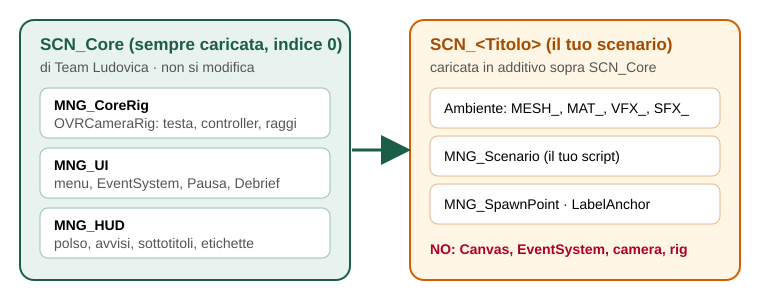

| Scena | Contenuto | Chi la possiede |
| --- | --- | --- |
| `SCN_Core` | rig (`MNG_CoreRig` con dentro `OVRCameraRig` di Meta, modelli dei controller e raggi), `MNG_UI`, `MNG_HUD`. Sempre caricata, prima nelle Build Settings (indice 0) | Team Ludovica |
| `SCN_<Titolo>` | solo il tuo scenario: ambiente, oggetti, `MNG_Scenario`, `LabelAnchor`. Caricata in **additivo** sopra SCN_Core da Home → Mission Brief → Avvia | il tuo team |

- Premere **Play direttamente nella tua scena** funziona da solo (solo Editor): `ScenarioController` carica SCN_Core in additivo, inizia una sessione al livello `editorLevel` (Guided), nasconde il menu e parte.
- Il giocatore parte da `MNG_SpawnPoint`: all'avvio l'origine del rig viene portata lì (posizione e rotazione sul piano) e ripristinata allo scaricamento.
- Il kit (`SCN_Core`, `SCN_ScenarioTemplate`, `SO_Mission_Template`) è già nel progetto: `SCN_Core` è in `Assets/_Project/Home/Level/Scenes/`, il modello di scenario in `Assets/_Project/Shared/Level/ScenarioTemplate/`. La UI comune sta tutta in `Assets/_Project/Home/`: usala, ma non modificare i suoi file. **Non eseguire i menu `SI81/UI/Build...` né `SI81/Scenari/Crea kit scenario`**: rigenerano i prefab comuni e `SCN_Core`. Se il kit manca o è rotto, chiedi al Team Ludovica.

Il giro completo di una partita. Tu lavori solo sulle due caselle arancioni, il resto lo fa la UI comune:

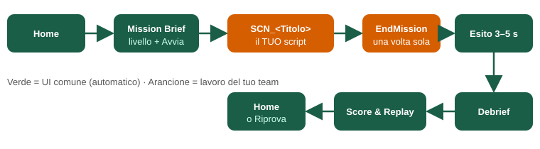

<!-- pagebreak -->

## 3. Passi per aggiungere uno scenario

Scenario nuovo: segui i passi 1–8. Scena già iniziata: vai a "Hai già iniziato una scena?" alla fine di questa sezione.

### Passo 1 · Crea lo scenario

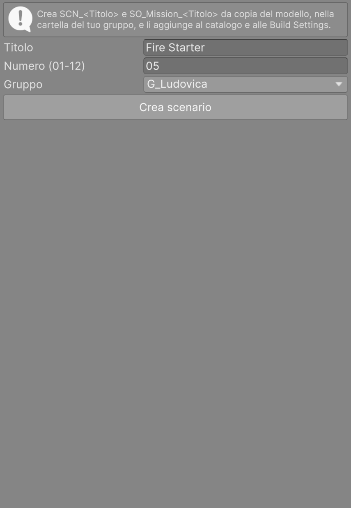

Menu `SI81/Scenari/Nuovo scenario...` e compila:

- **Titolo**: es. "Fire Starter". Solo lettere inglesi, cifre e spazi.
- **Numero**: 01–12, libero.
- **Gruppo**: la tua cartella in `Assets/_Project/Groups/` (es. `G_Marius`). Deve già esistere.

Il numero e il titolo non devono essere già nel catalogo: il catalogo contiene già 8 missioni di esempio (§9). Se il tuo scenario prende il posto di una di queste, **prima** apri `SO_MissionCatalog` e togli la missione di esempio dalla lista `Missions`, poi usa `Nuovo scenario...`. Altrimenti la finestra dà errore ("numero già usato").

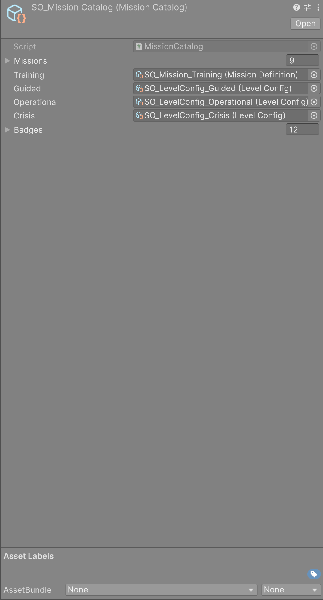

La finestra crea in `Assets/_Project/Groups/<gruppo>/Scenari/<Titolo>/` i file `SCN_<Titolo>.unity` e `SO_Mission_<Titolo>.asset`. La missione è **già nel catalogo** (`SO_MissionCatalog`) e la scena **già nelle Build Settings**. I testi da scrivere sono marcati `[DA COMPILARE]`.

> Non creare la scena e la missione a mano copiando file: la finestra collega anche missione, catalogo e Build Settings. Se lo fai a mano, quasi sempre manca uno dei tre.


<div style="clear:both"></div>

### Passo 2 · Compila `SO_Mission_<Titolo>`

![SO_Mission nell'Inspector. Ogni campo con [DA COMPILARE] va riscritto.](img~/03_inspector_mission_template.png "w=40% h=250 right")

Seleziona `SO_Mission_<Titolo>` nella cartella del tuo scenario e compila i campi, uno per uno:

| Campo | Regola |
| --- | --- |
| `Id` | 2 cifre, `01`–`12`, unico (`00` = Training, `99` = mock: riservati) |
| `Title` | es. `Fire Starter`; nella UI appare "01 · Fire Starter" |
| `Context` | ruolo e situazione, **≤ 280 caratteri** |
| `Objectives` | **1–4** righe, **≤ 30 caratteri** ciascuna (è la larghezza del polso) |
| `Criteria` | un criterio breve (una riga) per Positivo, Parziale, Negativo: appaiono in Mission Brief |
| `Levels` | per Guided / Operational / Crisis: sbloccato di default e `TimeLimitSecondsOverride` (0 = tempo del livello). Lascia 0 in Guided: un valore > 0 mette il conto alla rovescia anche in Guided |
| `Complexity` | 1–5 |
| `Icon` | icona `ICN_` bianca per la card (`Image` facoltativa, `Gradient*` per i colori) |
| `SceneName` | **esattamente** `SCN_<Titolo>` in PascalCase (es. `SCN_FireStarter`) |

Dove finiscono questi campi nel gioco: `Title` e numero in alto, `Context` nella Descrizione, `Objectives` sotto la Descrizione, `Criteria` nel pannello a sinistra (Criteri di completamento), `Complexity` nei pallini.


<div style="clear:both"></div>

### Passo 3 · Costruisci l'ambiente


Nella scena: sostituisci `MESH_Floor` e gli oggetti di esempio (`MESH_Example*`) con il tuo ambiente e sposta `MNG_SpawnPoint` dove deve partire il giocatore. Niente UI a mano.

- `MNG_Light`: luce di base, puoi cambiarla.
- `MNG_SpawnPoint`: la freccia blu indica dove guarda il giocatore all'inizio.
- `MNG_Scenario`: qui va il tuo script (passo 5). Non eliminarlo.

Dai i nomi con i prefissi del §5 (`MESH_`, `MAT_`, `VFX_`, `SFX_`...): il validatore controlla anche questo.

### Passo 4 · Metti i `LabelAnchor`

Aggiungi il componente `LabelAnchor` (Add Component → `LabelAnchor`) sugli oggetti importanti. Scegli il tipo in `Kind` (Risk / Interaction / ContextHelp, vedi §4) e scrivi il testo direttamente nei campi `Title` / `Detail` dell'Inspector.


<div style="clear:both"></div>

> L'etichetta appare e sparisce da sola in base alla distanza e al livello. Non devi accenderla o spegnerla dal codice, tranne quando l'oggetto viene afferrato (`Suppressed = true`).


<div style="clear:both"></div>

### Passo 5 · Scrivi lo script dello scenario

Crea una classe che eredita da `ScenarioController` e mettila su `MNG_Scenario` **al posto** del componente di base. La missione assegnata nel campo `Mission` deve restare la tua.

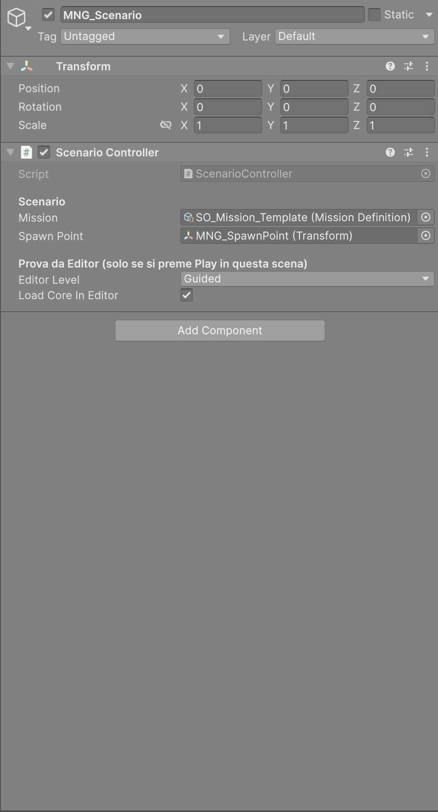

Come fare il cambio senza perdere i collegamenti:

1. Seleziona `MNG_Scenario`.
2. Aggiungi il tuo componente (es. `FireStarterScenario`).
3. Trascina nel tuo componente la stessa `SO_Mission` e lo stesso `MNG_SpawnPoint`.
4. Rimuovi il componente `ScenarioController` di base.

Esempio minimo di script:

```csharp
using SI81.UI;
using System.Collections.Generic;

public class FireStarterScenario : ScenarioController
{
    protected override void OnScenarioStarted()
    {
        Subtitle("Caposquadra", "Controlla il quadro elettrico.");
        SetHint("Guarda il quadro a destra");
    }

    // Chiamato quando il giocatore fa la cosa giusta (es. da un UnityEvent o dalla tua logica).
    public void OnAlarmGiven()
    {
        Feedback("Allarme dato", FeedbackKind.Positive);
        CompleteObjective();
        EndMission(OutcomeType.Positive, -1, new[] { 95, 88, 90, 85, 92 },
            new List<string> { DebriefLinePrefix.GOOD + "Hai dato l'allarme." });
    }
}
```

### Passo 6 · Chiudi la missione

Chiama `EndMission(...)` **una sola volta**, su ogni percorso possibile (vittoria, errore grave, tempo scaduto). Il tempo scaduto è già gestito da `OnTimerExpired()`. Dopo `EndMission` la UI mostra da sola esito, Debrief e Score & Replay (§4).

### Passo 7 · Valida

Menu `SI81/Scenari/Valida scenario` con la tua scena aperta, oppure `Valida tutti gli scenari`. Correggi tutti gli errori rossi (§7).

### Passo 8 · Prova

Play nella tua scena (Guided), poi il percorso completo: apri `SCN_Core` → Play → Home → la tua card → Avvia. Prova anche Operational e Crisis. Infine sul visore Quest 3, partendo sempre da `SCN_Core`.

<div style="clear:both"></div>

### Hai già iniziato una scena? Portala dentro così

Se il tuo team ha già una scena con ambiente, oggetti e script, **non serve rifarla**. Si porta dentro il kit in uno dei due modi qui sotto. Prima di iniziare: fai un commit della scena com'è adesso (così puoi tornare indietro) e fai pull dell'ultima versione del progetto.

**Prima di tutto, in qualunque modo scegli, togli dalla tua scena:**

- camera, `AudioListener`, `OVRCameraRig`, XR Origin e Building Block di Meta: il rig è uno solo e sta in `SCN_Core`. Segna dove stava il giocatore: lì metterai `MNG_SpawnPoint`;
- `Canvas`, `EventSystem`, input module e qualunque pannello fatto a mano;
- componenti di XR Interaction Toolkit (non approvato dal team).

Se le tue interazioni (afferrare, teletrasporto) erano attaccate al tuo rig, non tenerlo: chiedi al team VR Interaction System come collegarle al rig condiviso.

**Modo A · consigliato: nuova scena dal kit, ci sposti dentro il tuo ambiente**

Va bene quasi sempre. È il più sicuro perché scena, missione, catalogo e Build Settings li collega la finestra.

1. `SI81/Scenari/Nuovo scenario...` con il tuo titolo, numero e gruppo (§3 passo 1).
2. Apri la scena nuova. Trascina la tua scena vecchia nella Hierarchy: Unity le apre insieme.
3. Seleziona gli oggetti radice del tuo ambiente nella scena vecchia e trascinali nella scena nuova (sempre nella Hierarchy). Sposta insieme gli oggetti che si riferiscono tra loro: un riferimento tra oggetti di scene diverse si perde.
4. Elimina `MESH_Floor` e gli oggetti `MESH_Example*` del modello. Metti `MNG_SpawnPoint` dove stava il tuo giocatore (freccia blu = direzione dello sguardo).
5. Le luci: le impostazioni di illuminazione (skybox, luce ambiente, lightmap) sono **della scena**, non degli oggetti. Riapri `Window > Rendering > Lighting` nella scena nuova, rimetti skybox e luce ambiente come prima e rifai il bake se usavi lightmap.
6. Togli la scena vecchia dalle Build Settings (`File > Build Profiles > Scene List`), così nel gioco ce n'è una sola. Puoi tenerla nel progetto come copia.

**Modo B · tieni il tuo file di scena**

Solo se la scena è molto grande o ha un bake di luci lungo da rifare.

1. Rinomina la scena in `SCN_<Titolo>` (dalla finestra Project di Unity, mai da Esplora file) e spostala in `Assets/_Project/Groups/<gruppo>/Scenari/<Titolo>/`.
2. Apri anche `SCN_ScenarioTemplate` (in `Assets/_Project/Shared/Level/ScenarioTemplate/`), copia `MNG_Scenario` e `MNG_SpawnPoint` (Ctrl+C) e incollali nella tua scena (Ctrl+V). Chiudi il modello **senza salvarlo**.
3. Duplica `SO_Mission_Template` (Ctrl+D), rinominalo `SO_Mission_<Titolo>`, spostalo nella cartella del tuo scenario e compilalo (§3 passo 2). `SceneName` = `SCN_<Titolo>`.
4. Su `MNG_Scenario` trascina la tua `SO_Mission_<Titolo>` nel campo `Mission` (incollato punta ancora al modello) e `MNG_SpawnPoint` nel campo `Spawn Point`.
5. Apri `SO_MissionCatalog` e aggiungi la tua missione alla lista `Missions` (togli prima la missione di esempio che sostituisci, §9).
6. Aggiungi la scena alle Build Settings, **dopo** `SCN_Core`.

**Poi, in tutti e due i modi:**

- I tuoi script di gioco restano tuoi. Il gestore dello scenario diventa una classe che eredita da `ScenarioController` (§3 passo 5): se avevi già un manager, fallo ereditare da `ScenarioController` oppure dagli un riferimento a `MNG_Scenario` e chiama da lì `SetObjective`, `Alert`, `AskDecision`, `EndMission`.
- I tuoi pannelli di testo diventano: etichette sugli oggetti → `LabelAnchor`; messaggi → `Alert` / `Feedback` / `Subtitle`; scelte → `AskDecision`; fine → `EndMission` (§4).
- Rinomina gli oggetti con i prefissi del §5.
- `SI81/Scenari/Valida scenario` fino a **0 errori**: il validatore elenca proprio quello che è rimasto da togliere (camera, Canvas, nomi).
- Prova come al passo 8, partendo anche da `SCN_Core`.

## 4. API in breve

### `ScenarioController` (usala nei tuoi script)

| Metodo | Cosa fa |
| --- | --- |
| `OnScenarioStarted()` (override) | sessione, HUD e primo obiettivo pronti: qui parte la logica |
| `OnTimerExpired()` (override) | di default chiude con esito Negativo, punteggio 20, riga di debrief "- Tempo scaduto..." |
| `SetObjective(int)` / `CompleteObjective()` | obiettivo corrente (0-based, contatore "n/N" sul polso); `Complete` passa al successivo |
| `SetPhase(string)` | `PHASE_SCAN / DECISION / ACTION / RESOLUTION` (`hud.phase.*`) |
| `SetHint(string)` | suggerimento, **solo Guided** (~60 caratteri) |
| `Alert("Titolo\nDettaglio", icona)` | avviso evento, 3 s, suono + aptica |
| `Feedback(testo, FeedbackKind)` | Positive / Neutral / Negative; Guided sempre, Operational solo Negative, Crisis mai |
| `Subtitle(parlante, testo, secondi)` | max 32 caratteri × 2 righe; testi lunghi in pagine automatiche |
| `AskDecision(domanda, opzioni[], callback, timeout)` | pannello a 1,2 m, 2–4 opzioni (~34 caratteri); callback con indice o `-1` se il tempo scade; `false` se manca il pannello |
| `EndMission(esito, punteggio, dimensioni, righe)` | chiude: punteggio 0–100 (passa `-1` e viene calcolato come media delle dimensioni), 5 dimensioni, righe di debrief |

Proprietà utili: `Mission`, `Level`, `IsRunning`, `CurrentObjectiveIndex`, `ObjectivesCompleted`, `ElapsedSeconds`. I metodi sono `public`, quindi li puoi chiamare anche da un `UnityEvent` (esempio: `ScenarioTrigger`, innesco a distanza dalla testa, senza fisica).

### Dove compare ogni cosa

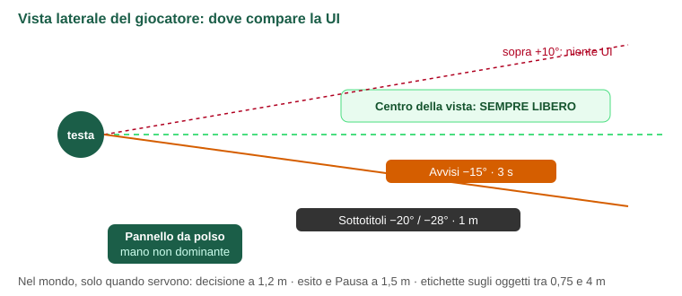

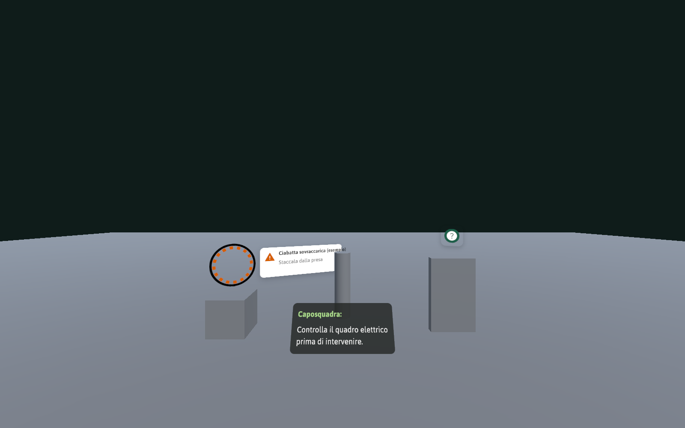

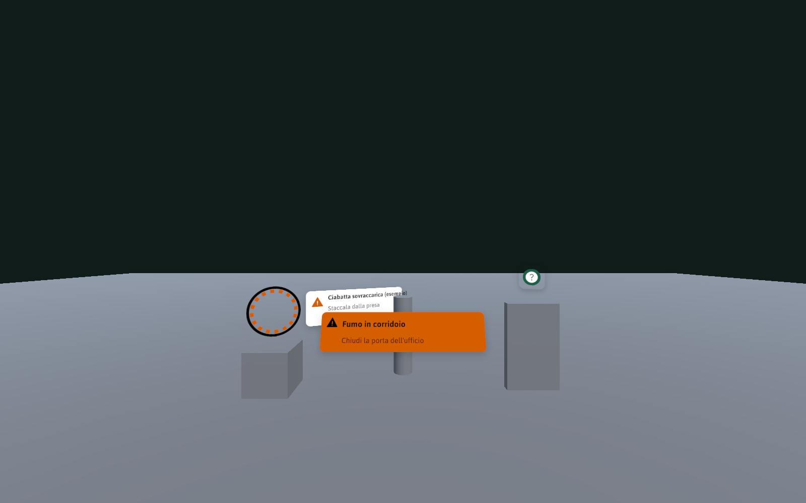

<div style="clear:both"></div>


### `HUDService` (statico: solo se non erediti da `ScenarioController`)

`SetObjective(testo)`, `SetObjectiveIndex(n)`, `SetPhase(chiave)`, `SetHint`, `StartTimer(secondi)` / `StopTimer`, `ShowEventAlert`, `ShowActionFeedback`, `ShowSubtitle`, `ShowSoundEvent("Allarme antincendio", critico)` (sottotitolo per suoni critici, mostrato anche con sottotitoli spenti), `ClearSubtitle`, `Pulse(ampiezza, durata, nonDominante)`. Se la HUD non è in scena scrive **un** avviso in Console e ignora la chiamata. Il timer parte da solo all'inizio della missione: non serve `StartTimer`.

### `LabelAnchor` (componente da mettere sugli oggetti)

| Tipo | Mostra | Quando |
| --- | --- | --- |
| `Risk` | `HUD_RiskLabel` (titolo + istruzione) | Guided e Operational; **max 3 insieme** (le più vicine) |
| `Interaction` | `HUD_InteractionPrompt` (tasto + verbo) | tutti i livelli |
| `ContextHelp` | `HUD_ContextHelp` (aiuto su 2 righe) | solo Guided |

Compare da sola tra **0,75 e 4 m** dalla testa. Campi: `title`/`detail` (testo tuo) oppure `titleKey`/`detailKey` (chiavi di `SO_UIStrings_It`), `offset` (es. 0, 0.3, 0 sopra l'oggetto), `icon`, per Interaction `buttonKey` / `actionKey`. Per nasconderla (oggetto afferrato): `Suppressed = true`.

### Livelli (da `SO_LevelConfig_*`)

| Livello | Evidenziazione | Suggerimenti | Risk | ContextHelp | Obiettivi sul polso | Timer |
| --- | --- | --- | --- | --- | --- | --- |
| Guided | sì | sì | sì | sì | sì | tempo trascorso |
| Operational | no | no | sì | no | sì | conto alla rovescia 600 s |
| Crisis | no | no | no | no | sì | conto alla rovescia 300 s |

Avvisi alle soglie 60 s e 30 s. `MissionDefinition.Levels[].TimeLimitSecondsOverride` sostituisce il tempo del livello. Non leggere il livello per decidere cosa mostrare: lo fa la UI. Leggi `Level` solo per la **logica di gioco** (es. più fuoco in Crisis).


### Punteggio, stelle e dimensioni

- **SPI (Indice di sicurezza) 0–100** = media delle **5 dimensioni** (0–100 ciascuna, in quest'ordine): `Safety, Awareness, Decision, Execution, Time`. Passa sempre `-1` come punteggio in `EndMission`, così la media la calcola la UI e non può essere diversa dalle dimensioni.
- **Stelle (0–5) = rank**, calcolate da `ScoreRules.StarsFromScore` con soglie 20 / 40 / 60 / 80 / 90 (token `score.stars.N.min` del tema). Non le calcoli tu.
- Esito: `OutcomeType.Positive / Partial / Negative` (deciso dal tuo scenario secondo i `Criteria`).
- **Righe di debrief** (italiano, una per decisione/errore), con prefisso: `DebriefLinePrefix.GOOD` = `"+ "` decisione corretta · `BAD` = `"- "` decisione sbagliata · `CRITICAL` = `"! "` errore critico.
- Dopo `EndMission` la UI comune fa il resto: esito → Debrief → Score & Replay → Home.

Esempio: questa chiamata produce le tre schermate qui sotto.

```csharp
EndMission(OutcomeType.Partial, -1, new[] { 80, 75, 60, 70, 65 }, new List<string> {
    DebriefLinePrefix.GOOD + "Hai dato l'allarme subito → i colleghi sono usciti in tempo",
    DebriefLinePrefix.BAD + "Hai avvisato il coordinatore dopo 2 min → squadra in ritardo",
    DebriefLinePrefix.CRITICAL + "Ti sei avvicinato al fumo senza abbassarti → esposizione al fumo" });
```


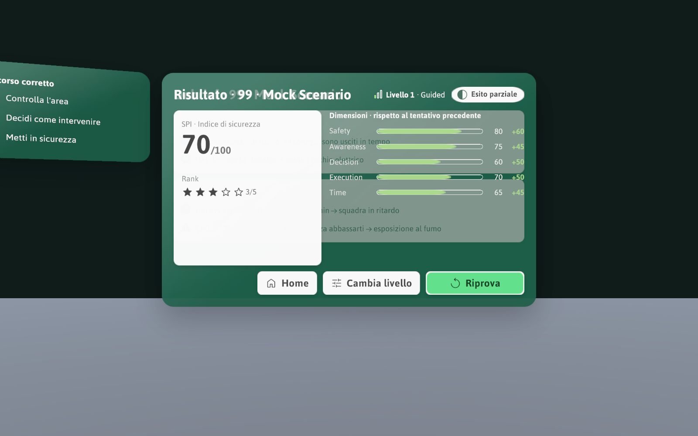


<div style="clear:both"></div>


## 5. Regole di naming

Prefisso MAIUSCOLO + `_` + PascalCase inglese, senza spazi, accenti né `è ' / & -`. Dopo il prefisso niente altri underscore (`BTN_StartMission`, non `BTN_start_mission`), tranne per le varianti, che vanno in fondo come suffisso (`TEX_BrickWall_Albedo`). Nome per **funzione**, mai per colore (`BTN_Retry`, non `BTN_RedButton`). Nome in scena = nome dell'asset. Stessa cosa, stesso nome: un solo termine per ogni funzione in tutto il progetto.

Prefissi ammessi:

| Prefisso | Cos'è |
| --- | --- |
| `SCN_` | scena Unity |
| `SO_` | ScriptableObject (dati di configurazione) |
| `MNG_` | manager / oggetto di gestione in scena |
| `MESH_` | modello 3D |
| `MAT_` | materiale |
| `TEX_` | texture |
| `SFX_` | effetto sonoro breve |
| `VFX_` | effetto visivo (fumo, scintille, fuoco) |
| `ANIM_` | animazione o clip |
| `ICN_` | icona |
| `FNT_` | font |
| `CANVAS_`, `BTN_`, `IMG_`, `PANEL_`, `LBL_`, `HUD_` | solo UI comune: **non** usarli nella tua scena (§6) |

Esempi per il tuo scenario:

| Cosa | Esempio |
| --- | --- |
| Scena | `SCN_FireStarter` |
| Missione | `SO_Mission_FireStarter` |
| Gestore dello scenario in scena | `MNG_Scenario`, `MNG_SpawnPoint`, `MNG_Light` |
| Modelli, materiali, texture | `MESH_ElectricalPanel`, `MAT_PanelMetal`, `TEX_PanelDirty` |
| Suoni / effetti | `SFX_AlarmFire`, `VFX_Smoke` |
| Icone | `ICN_Warning` |
| Chiavi di testo (se le usi) | `hud.alert.fire_spreading`: minuscolo, punti, snake_case, inglese |

- Classi e script **senza prefisso** (`FireStarterScenario`); PascalCase per classi, funzioni e variabili pubbliche; camelCase per le private; MAIUSCOLO per le costanti. Commenti e `/// <summary>` su ogni funzione, **in italiano**.
- **Testi dello scenario** (obiettivi, avvisi, sottotitoli, domande, etichette, righe di debrief): dati dello scenario, stanno nel `SO_Mission` o nel tuo script. **Non** vanno in `SO_UIStrings_It` (è dei testi della UI comune). Se in un `LabelAnchor` usi una chiave, deve esistere: il validatore la controlla.
- Tutto il testo mostrato al giocatore è in **italiano**.

## 6. Cosa NON fare

- Niente `Canvas`, `EventSystem`, `InputModule`, `HUD_*`, `PANEL_*`, `CANVAS_*`, `MNG_UI`, `MNG_HUD` nella scena dello scenario.
- Niente `TrackedDeviceRaycaster`, niente XR Interaction Toolkit (non approvato dal team).
- Niente camera, `AudioListener` o rig propri, neanche un `OVRCameraRig` o un Building Block di Meta: il rig sta in `SCN_Core`. Con due rig la UI resta ferma davanti agli occhi, i controller non si vedono e il raggio sparisce.
- Niente pannelli fissi davanti agli occhi o agganciati alla testa; niente testo al centro della vista. Tutto ciò che serve esiste già (polso, avvisi bassi, sottotitoli bassi, `LabelAnchor`, decisione world-locked).
- **Non chiamare `IProgressService.RecordResult`**: lo fa già `MissionSession.End` (chiamarlo conta il risultato due volte). Chiama `EndMission` **una volta sola**.
- Non mostrare il punteggio con un'altra formula: a schermo è sempre "SPI N/100" e lo scrive la UI comune, non il tuo scenario.
- Non duplicare né modificare i prefab comuni; non creare varianti locali. Serve qualcosa di nuovo? Chiedilo al Team Ludovica.
- Non rinominare `SCN_Core` né toglierla dall'indice 0 delle Build Settings.
- Oltre 3 etichette Risk entro 4 m, righe obiettivo > 30 caratteri, sottotitoli > 32 caratteri per riga: la UI taglia o impagina.

<!-- pagebreak -->

## 7. Validatore (`SI81/Scenari/Valida scenario`)

Controlla la scena aperta; `Valida tutti gli scenari` apre in additivo ogni scena del catalogo. Gli **errori** compaiono in rosso in Console e nella finestra, gli **avvisi** in giallo; un clic su una riga seleziona l'oggetto. Ogni messaggio inizia con `[nome asset/scena]`, dice cosa non va e come correggerlo.

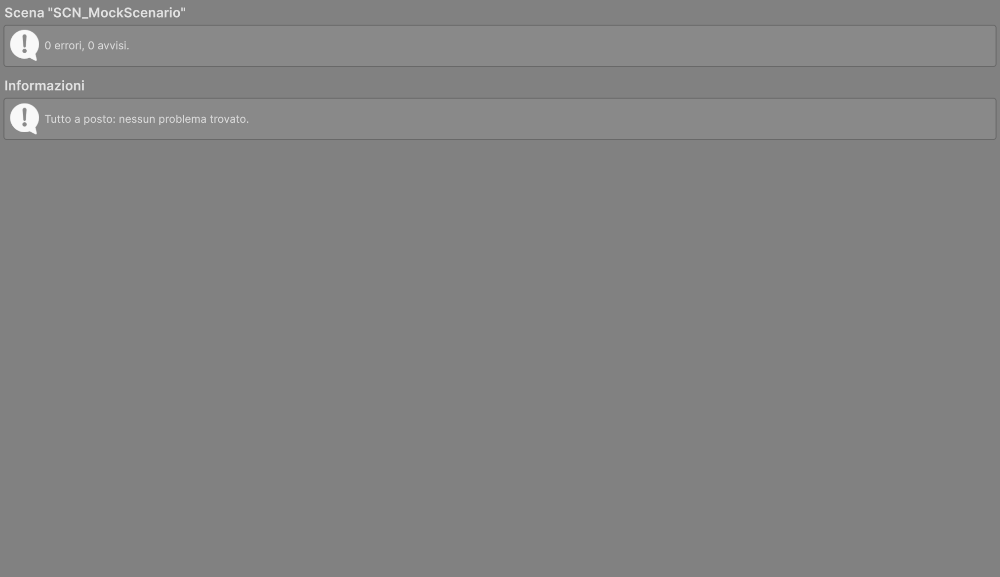


Cosa verifica:
- **Missione**: nome `SO_Mission_<PascalCase>` coerente col titolo · titolo non vuoto · `Id` a 2 cifre e unico · contesto ≤ 280 · 1–4 obiettivi di ≤ 30 caratteri · un criterio per Positivo/Parziale/Negativo · livelli · complessità 1–5 · icona · `SceneName` = `SCN_<Titolo>` · presenza nel catalogo · nessun marcatore `[DA COMPILARE]` rimasto.
- **Scena**: esiste, nome = `SceneName`, è nelle Build Settings e attiva (e `SCN_Core` è all'indice 0) · un solo `ScenarioController` con la tua missione · nessun Canvas / EventSystem / InputModule / `TrackedDeviceRaycaster` / `MNG_UI` / `MNG_HUD` / `HUD_*` / `PANEL_*` / componenti comuni · nessuna Camera (errore) · nessun AudioListener (avviso) · nessuno script mancante · nomi con prefisso SI81 nel formato `PREFISSO_PascalCase` (avviso) · `LabelAnchor` con titolo (avviso), max 3 rischi entro 4 m (avviso) · chiavi di testo esistenti in `SO_UIStrings_It`.

Gli errori vanno corretti prima della consegna; gli avvisi sono consigliati. Il validatore non blocca la build. Le missioni di esempio (`(esempio)` in `DesignerNote`) senza scena danno solo un avviso: il team che la sostituisce la toglie dal catalogo (§3 passo 1).


## 8. Checklist finale

- [ ] Creato con `Nuovo scenario...`; nessun `[DA COMPILARE]` rimasto nei testi.
- [ ] `Id` unico (01–12), `SceneName` = `SCN_<Titolo>`, scena nelle Build Settings.
- [ ] Contesto ≤ 280; obiettivi 1–4, ≤ 30 caratteri; 3 criteri; complessità e icona impostate.
- [ ] Nessun Canvas, EventSystem, camera, rig o UI nella scena.
- [ ] `MNG_Scenario` con la tua classe che eredita da `ScenarioController` e la missione assegnata.
- [ ] `LabelAnchor` sugli oggetti chiave, max 3 Risk insieme.
- [ ] `EndMission` chiamata una sola volta, su ogni percorso (anche tempo scaduto), con esito, punteggio `-1`, 5 dimensioni e righe di debrief con prefisso `+ ` / `- ` / `! `.
- [ ] Nessuna chiamata a `RecordResult`, testi in italiano.
- [ ] Provato in Guided, Operational e Crisis (Play nella tua scena).
- [ ] Provato il percorso completo: Home → Mission Brief → scena → esito → Debrief → Score & Replay → Home.
- [ ] `Valida scenario` senza errori in Console.
- [ ] Console pulita in Play Mode; sul visore nessun pannello fisso davanti agli occhi, controller e raggio visibili.

**A chi chiedere**: UI comune, prefab, kit, validatore, rig e spawn → **Team Ludovica** (owner, referente Romario Gjoka). Locomozione e interazione con gli oggetti → **VR Interaction System**. Valori dei livelli, soglie delle stelle e posa del polso → Team Ludovica.

## 9. Training comune e scene mancanti

- `SO_Mission_Training` (Id `00`) è nel catalogo con obiettivi e criteri, ma **`SCN_Training` non esiste ancora**: la crea il team che possiede il training (movimento, afferrare, selezionare con il raggio, Pausa). **Non usare `Nuovo scenario...`** (accetta solo i numeri 01–12): duplica `SCN_ScenarioTemplate` nella cartella del suo gruppo (`Assets/_Project/Groups/<gruppo>/Scenari/Training/`), rinominala `SCN_Training`, mettila nelle Build Settings dopo `SCN_Core` e assegna `SO_Mission_Training` al campo `Mission` di `MNG_Scenario`. Finché manca, il pulsante Training resta non disponibile e il validatore dà un avviso.
- Le 8 missioni di esempio (Id 01–04, 07–10) hanno la scena solo sulla carta: ogni team toglie dal catalogo la missione di esempio che sostituisce e poi crea la sua con `Nuovo scenario...` (stesso `Id`), come al §3 passo 1.
- `SO_Mission_MockScenario` (Id 99) va tolta dal catalogo alla consegna.


## 10. Timeline delle scelte nel Debrief (in arrivo)

Il Debrief mostrerà anche una **timeline delle scelte**: ogni decisione o errore con il minuto in cui è successo e la sua conseguenza, in ordine di tempo. Esempio:

`0:45 · Hai aperto la porta senza controllare la temperatura della maniglia → Conseguenza: flashover / ustione`

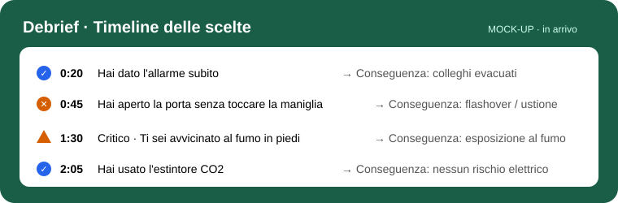

La funzione **non è ancora nella UI comune**: la aggiunge il Team Ludovica nella prossima versione. Il metodo previsto è questo:

| Metodo (in arrivo) | Cosa farà |
| --- | --- |
| `RecordChoice(azione, conseguenza, tipo)` | registra una scelta; il tempo lo prende da solo da `ElapsedSeconds`; `tipo` = corretta / sbagliata / critica (stessa icona delle righe `+ ` / `- ` / `! `) |

Finché non c'è, **non chiamarlo** (il progetto non compila). Cosa fare già adesso, così dopo basta cambiare una riga:

- Per ogni decisione o errore importante, nel momento in cui succede, salva nel tuo script `ElapsedSeconds`, l'azione e la conseguenza.
- Scrivi l'azione in seconda persona, al passato ("Hai aperto la porta..."), max **60 caratteri**. La conseguenza è breve, max **40 caratteri** ("flashover / ustione").
- Al massimo **8 scelte** per partita: solo quelle che contano per il risultato.
- Continua a passare le righe di debrief a `EndMission` come oggi, nella forma `azione → conseguenza`.

Quando la funzione esce, il Team Ludovica avvisa i team e aggiorna questa guida.

<!-- pagebreak -->

## 11. Farsi aiutare da un assistente AI

Puoi usare un assistente AI (Claude, ChatGPT, Copilot...) per integrare il tuo scenario. Perché ti dia risposte giuste per questo progetto devi dargli **due file**:

- `Assets/_Project/Docs/UI_INTEGRATION_FOR_AI.md`: le istruzioni scritte per l'assistente (regole, API esatte, cosa non fare, come aggiungere componenti);
- questa guida (`Assets/_Project/Docs/GUIDA_INTEGRAZIONE_SCENARIO.md` o il PDF).

Allegali alla chat, oppure, se l'assistente lavora dentro il progetto, digli di leggerli. Poi copia il prompt del tuo caso e sostituisci le parti tra `< >`.

> Regole per tutti i prompt: scrivi sempre gruppo, titolo e numero dello scenario. Se l'assistente propone una camera, un Canvas, XR Interaction Toolkit o di modificare la UI comune, fermalo: è vietato (§6). Prima di consegnare, il validatore deve dare 0 errori.

### Caso 1 · Scenario nuovo da zero

```
Leggi Assets/_Project/Docs/UI_INTEGRATION_FOR_AI.md e Assets/_Project/Docs/GUIDA_INTEGRAZIONE_SCENARIO.md.
Siamo il gruppo <G_Nome>. Dobbiamo creare lo scenario <NN · Titolo> da zero.
Cosa succede nello scenario: <2-3 righe>.
Obiettivi (max 4, max 30 caratteri): <...>.
Esito positivo / parziale / negativo: <...>.
Guidami passo per passo: Nuovo scenario, compilazione della SO_Mission,
LabelAnchor da mettere e script che eredita da ScenarioController.
```

### Caso 2 · Abbiamo già una scena da portare dentro

```
Leggi Assets/_Project/Docs/UI_INTEGRATION_FOR_AI.md e Assets/_Project/Docs/GUIDA_INTEGRAZIONE_SCENARIO.md.
Siamo il gruppo <G_Nome>. Abbiamo già una scena: <nome file e percorso>.
Contiene: <rig/camera sì o no, Canvas o pannelli, script principali, luci baked sì o no>.
Lo scenario sarà <NN · Titolo>.
Dimmi se usare il Modo A o il Modo B (§3 "Hai già iniziato una scena?")
e guidami passo per passo, compreso cosa togliere dalla scena.
```

### Caso 3 · Scrivere lo script dello scenario

```
Leggi Assets/_Project/Docs/UI_INTEGRATION_FOR_AI.md.
Scrivi lo script completo dello scenario <NN · Titolo> (gruppo <G_Nome>),
classe <NomeClasseScenario> che eredita da ScenarioController.
Sequenza degli eventi: <1. ... 2. ... 3. ...>.
Decisioni del giocatore e conseguenze: <...>.
Usa solo le API del file, summary in italiano, EndMission una volta su ogni percorso,
punteggio -1 e righe di debrief "azione → conseguenza".
```

### Caso 4 · Il validatore dà errori

```
Leggi Assets/_Project/Docs/UI_INTEGRATION_FOR_AI.md.
Il validatore (SI81/Scenari/Valida scenario) sulla scena <SCN_Titolo> dice:
<incolla qui tutti i messaggi rossi e gialli>
Spiegami cosa vuol dire ogni errore e come correggerlo in Unity, uno per uno.
```

### Caso 5 · Sul Quest la UI non risponde

```
Leggi Assets/_Project/Docs/UI_INTEGRATION_FOR_AI.md (caso E).
Sul Quest 3 il menu non risponde: <cosa si vede: raggi corti / nessun raggio / hover ma niente clic>.
APK fatto dopo l'ultimo pull: <sì/no>. In Console durante la build c'era la riga [SI81 Build]: <sì/no>.
Ecco le righe del log che contengono "SI81" e quelle con "ERROR": <incolla>.
Dimmi cosa significa e cosa devo mandare al Team Ludovica.
```

### Caso 6 · Ci serve un componente in più

```
Leggi Assets/_Project/Docs/UI_INTEGRATION_FOR_AI.md (sezione 7).
Nello scenario <NN · Titolo> ci serve: <descrizione, es. una valvola che completa l'obiettivo
quando viene chiusa / un indicatore della temperatura della porta>.
Dimmi se si può fare con quello che esiste (Alert, Subtitle, AskDecision, LabelAnchor).
Se serve un componente di scenario, scrivilo nella cartella del nostro gruppo seguendo il modello del file.
Se invece serve un nuovo elemento di UI, compila la richiesta per il Team Ludovica.
```

### Caso 7 · Etichette e messaggi al posto dei nostri pannelli

```
Leggi Assets/_Project/Docs/UI_INTEGRATION_FOR_AI.md.
Nella nostra scena avevamo questi pannelli/testi: <elenco con cosa mostravano e quando>.
Per ognuno dimmi con cosa sostituirlo (LabelAnchor Risk/Interaction/ContextHelp, Alert,
Feedback, Subtitle, AskDecision) e scrivi le chiamate o i valori da mettere nell'Inspector.
```

### Caso 8 · Scena del Training (solo per il team che la possiede)

```
Leggi Assets/_Project/Docs/UI_INTEGRATION_FOR_AI.md (caso F) e la guida §9.
Siamo il gruppo <G_Nome> e dobbiamo creare SCN_Training per SO_Mission_Training.
Il training deve insegnare: <movimento, afferrare, selezionare con il raggio, Pausa...>.
Guidami nella creazione della scena senza usare Nuovo scenario e scrivi lo script.
```

**Se la risposta non ti convince**: chiedi all'assistente in quale sezione del file o della guida è scritto quello che dice. Se non lo trova, chiedi al Team Ludovica.
