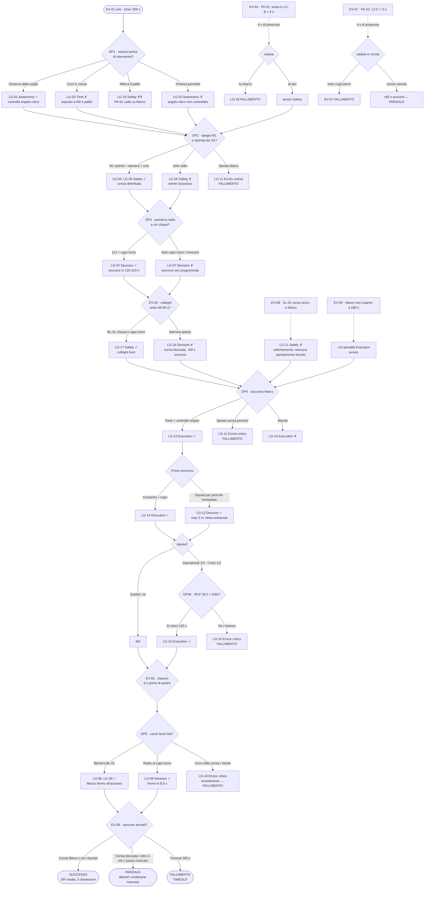

# Gruppo-XX_PW4_v01_Flowchart07 — Forklift Chaos

> Sostituire `XX` con il numero ufficiale del gruppo prima della consegna.
> Diagramma in Mermaid: renderizzabile su GitHub, convertibile in PDF per `COMMON_BUILD`.

## Legenda

- `✓` scelta corretta · `✗` rischioso o mancato · `✗✗` / "Errore critico" errore che chiude il livello.
- Le linee tratteggiate sono eventi dinamici che possono interrompere il flusso principale in qualsiasi momento.
- Ogni nodo con ID LG-* produce una riga nel debrief con minuto, esito e conseguenza.
- Il percorso corretto completo è riportato in fondo al debrief e nel SDD (§9).
