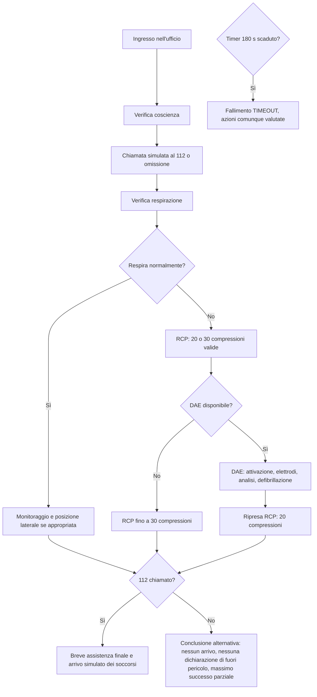

# Sicurezza Immersiva 81 — Specifiche di sviluppo: Man Down

> **Documento di riferimento per OpenCode e per il gruppo di sviluppo.**  
> Scenario 2 — **Man Down (ID 3)** · Unity / C# · VR · OpenXR · target di test: Meta Quest 3.  
> **Stato:** specifica funzionale aggiornata alle decisioni approvate dall'utente (2026-11-24/25), **non** attestazione di funzionalità già implementate.

## 1. Fonti, ambito e priorità

Questo documento consolida tre documenti di progetto:

1. **`Man_Down_GDD.pdf`** — GDD specifico dello scenario, fonte primaria per le meccaniche e gli esiti di Man Down.
2. **`FlowChart_ManDown.pdf`** — diagramma dei percorsi decisionali, inclusi il pericolo ambientale e i quattro Bad Ending.
3. **`Project Work VR - GDD.pdf`** — GDD generale di *Sicurezza Immersiva 81*, fonte per difficoltà, interazioni VR, punteggi, accessibilità e sistemi comuni.

**Le decisioni approvate dall'utente e registrate in `TASK_PROGRESS.md` (§ "Decisioni approvate" e "Decisioni integrative definitive") prevalgono su tutte le fonti precedenti in caso di incongruenze.** In particolare: niente pericolo ambientale né primo soccorso aziendale; solo modalità Realistica da 180 s; soglie 80/50; ID semantici; RCP con movimento fisico dei controller; DAE con elettrodi provvisori; mancata chiamata limita l'esito a successo parziale senza arrivo simulato dei soccorsi.

> **DECISIONE TASK 08.5 — sostituisce le vecchie soglie RCP:** nel ramo anomalo non ci sono più requisiti di 20/20/30 compressioni. La missione prosegue per una finestra di **45 s** dalla prima valutazione respiratoria anomala, con eventuale proroga **una sola volta** di **15 s** se il DAE è disponibile, estratto e senza scarica completata. La RCP genera un valore grezzo cumulativo (somma delle qualità degli intervalli); compressioni e qualità nella proroga sono registrate a parte e non alimentano lo scoring della finestra principale. Le occorrenze di 20/20/30 più avanti nel documento sono storiche e non operative.

> **TASK 09.3:** la notifica `SFX_Notifica_soccorsi` riproduce 2D una sola volta quando la chiamata al 112 viene registrata; la sirena `SFX_Ambulance` riproduce 2D a fine missione solo con 112, per ogni esito, con fade out 3 s a tempo non scalato. Due AudioSource dedicati allo scenario, separati dal DAE e dalla UI comune.

> **TASK 09.1:** il calcolo del punteggio è descritto in `Man_Down_Scoring_System.md` (sistema attuale). I valori mostrati qui per penalità/soglie storiche sono superati dal nuovo sistema; la missione non mostra punteggi e l'integrazione con esiti/debriefing è demandata al Task 09.2.

Per le discrepanze residue non coperte dalle decisioni: **non inventare una soluzione e non modificare automaticamente il comportamento**: segnala il conflitto e chiedi conferma. Questo file è un riassunto operativo e non sostituisce i PDF originali.

**Ambito del gruppo:** implementare il solo scenario Man Down e le risorse ad esso necessarie. Menu globali, impostazioni XR, leaderboard, salvataggi e sistemi comuni devono essere **riutilizzati se esistenti**, non duplicati.

## 2. Progetto generale

*Sicurezza Immersiva 81* è un serious game educativo VR single-player per supportare la formazione sulla sicurezza sul lavoro. Il giocatore, in prima persona, esplora ambienti lavorativi, valuta rischi, usa strumenti e prende decisioni durante emergenze. Le azioni ricevono feedback visivo, sonoro e testuale, con esito finale di successo, successo parziale o fallimento.

- **Engine e linguaggio:** Unity e C#.
- **Piattaforma:** OpenXR, visori VR/MR; il gruppo intende testare su Meta Quest 3.
- **Interazione generale:** movimento 6DoF, locomozione lineare e/o teleport, grab/drop, utilizzo strumenti, interazioni UI. La digitazione numerica prevista dal GDD generale non è richiesta: la chiamata al 112 è simulata.
- **Vincolo di integrazione:** identificare prima i componenti XR, prefab, input e scoring già presenti nel progetto. Il GDD **non definisce una mappatura esatta dei pulsanti** dei controller.
- **Accessibilità prevista dal GDD generale:** mano dominante selezionabile; palette distinguibile anche per daltonismo (esempio Okabe–Ito); testi leggibili. Le informazioni critiche non dipendono solo dal colore o solo dall'audio.

## 3. Obiettivo e situazione iniziale

Il giocatore entra in un ufficio e trova un collega incosciente a terra vicino a una scrivania. Deve controllare la coscienza, chiamare il **112**, valutare la respirazione e seguire il percorso appropriato fino all'arrivo simulato dei soccorsi, quando la chiamata è stata effettuata.

All'avvio di una partita si determinano casualmente, in modo **indipendente**, e si mantengono stabili per tutta la partita:

- **Respirazione dell'NPC:** anormale **70%**, normale **30%**.
- **Disponibilità del DAE:** presente **75%**, assente **25%**.

Le probabilità sono **configurabili dall'Inspector**. Per i test deve essere possibile **forzare manualmente entrambe le condizioni**, così da coprire tutte le combinazioni senza dipendere dalla randomizzazione.

**Nessuna pozzanghera e nessun rischio ambientale:** l'opzione del GDD specifico è esclusa da decisione approvata. Non si generano danni all'operatore né penalità Safety collegate.

## 4. Ambientazione e oggetti

| Elemento | Ruolo previsto |
|---|---|
| NPC incosciente a terra | Verifica di coscienza e respirazione; RCP; eventuale cambio posa; zone configurabili per torace ed elettrodi |
| Scrivania, computer | Arredamento e contesto dell'ufficio |
| Telefono | Chiamata simulata al 112 |
| DAE a parete | Strumento utilizzabile **solo se presente** nella partita; due elettrodi provvisori |
| Arredamento da ufficio | Ambientazione e navigazione |

Non esiste una mesh del DAE con elettrodi separati e afferrabili: si usa il modello disponibile più **due primitive Unity appiattite** con materiali semplici. La logica non dipende dalla mesh-specifica degli elettrodi, così una futura sostituzione non richiede modifiche al codice. **Decisione aggiornata il 2026-11-26 su richiesta esplicita dell'utente:** la precedente esclusione dei cavi è sostituita da due cavi visivi con `LineRenderer` (vedi §7.1.2); restano esclusi simulazioni fisiche dei cavi, adesione alla pelle e animazioni complesse.

Gli oggetti decorativi non richiedono automaticamente sistemi di interazione o prefab personalizzati. Riutilizzare asset e prefab condivisi come **istanze**, senza modificare gli originali.

## 5. Sequenza funzionale principale

### 5.1 Verifica della sicurezza

L'ambiente è considerato sicuro per direttiva approvata: non esistono pericoli ambientali da gestire, non c'è pozzanghera e non c'è un Bad Ending per esposizione al pericolo. Non si generano penalità Safety: la dimensione resta neutrale 5/5.

### 5.2 Coscienza e soccorsi

1. Il giocatore interagisce con l'NPC per verificarne lo stato di coscienza con GRIP su una spalla. TASK 05.2: l'etichetta `GRIP` / `Afferra` resta visibile fino alla prima verifica valida, poi viene nascosta e compare il popup informativo condiviso "La persona è incosciente." con un solo pulsante "OK". Il messaggio non suggerisce di controllare la respirazione.
2. Deve attivare i soccorsi con la **chiamata simulata al 112**. Interagendo con il telefono si apre il **popup decisionale comune** tramite `AskDecision("Chiami il 112?", new[] { "Sì", "No" }, callback, 0f)`: `Sì` (indice 0) chiama `Call112()` ed è l'unica scelta che registra la decisione; `No` (indice 1) chiude il popup **senza registrare alcuna azione** e lascia il telefono interagibile per un nuovo tentativo. Lo stato della chiamata è globale e autorevole in `ManDownScenario.IsCall112Made`: dopo un `Sì` accettato da qualsiasi telefono nessun altro telefono apre il popup, ma tutti restano fisicamente afferrabili. Non è previsto un timeout del popup. Se la chiamata non viene mai effettuata, la penalità `EMERGENCY_NOT_CALLED` resta applicabile alla conclusione. **Nessun tastierino numerico, Canvas aggiuntivo o sistema UI personalizzato**: si usa solo `HUD_DecisionPanel` del kit condiviso, compatibile con Operational.
3. Il **primo soccorso aziendale è escluso completamente**: nessuna chiamata aggiuntiva, nessuna attivazione automatica, nessun NPC dedicato, nessuna penalità relativa.
4. La mancata chiamata è registrata come `EMERGENCY_NOT_CALLED`: comporta la penalizzazione prevista e impedisce il successo completo, ma **non impedisce la conclusione della missione**. In quel caso non si simula l'arrivo dei soccorsi e non si dichiara che l'NPC sia fuori pericolo; l'esito massimo è successo parziale.
5. Il giocatore controlla la respirazione dell'NPC.

### 5.3 Percorso A — respirazione normale

1. TASK 05.2: avvicinando un controller davanti alla bocca e mantenendolo fermo per **2,5 s** (durata configurabile) si completa la verifica; il sistema comunica l'esito con il popup informativo condiviso "La persona respira normalmente." (un solo pulsante "OK"). Non compaiono etichette o indicatori di avanzamento per la zona.
2. Il giocatore monitora l'NPC e, se appropriato, può metterlo in posizione laterale: sostituzione/cambio posa semplificato, senza ragdoll.
3. Dopo le procedure fondamentali si svolge una **breve fase finale di assistenza**, senza attesa passiva prolungata; la durata è configurabile e va validata.
4. **Se il 112 è stato chiamato**, arriva simulato il soccorso e si valuta l'esito. **Se non è stato chiamato**, si applica la conclusione alternativa del §5.2: nessun arrivo, nessuna dichiarazione di fuori pericolo, esito massimo successo parziale.

#### 5.3.1 Sistema di pose e scelta della posizione (TASK 06.1)

- **Cinque pose statiche** su un solo NPC, gestite da `ManDownPoseController` sul GameObject `MESH_RiggedEmployee`: `Supine` (posizione iniziale), `Recovery` (laterale di sicurezza), `LegsRaised`, `Prone` e `Seated`. Ogni posa memorizza solo posizione e rotazione **locali** delle ossa dello scheletro esistente; la scala non viene mai salvata né applicata. L'applicazione è immediata, senza clip, Animator, interpolation o ragdoll. I dati sono serializzati nel componente e persistono nella scena.
- **Individuazione delle ossa:** vengono considerate solo le 73 ossa referenziate dagli `SkinnedMeshRenderer` e discendenti da `Hips`. Mesh, trigger, collider e oggetti estranei (per esempio `MESH_MouthZone` e `MESH_ShoulderGrip`) non rientrano nella memorizzazione. Non esiste un Animator sull'NPC che possa sovrascrivere le trasformazioni delle ossa.
- **Custom Inspector:** per ogni posa mostra lo stato *Configurata / Non configurata* e i pulsanti **Save Pose** (con conferma prima di sovrascrivere e blocco su scheletro non valido) e **Apply Pose**; permette di trovare `Hips`, catturare la posa corrente come `Supine` iniziale senza modificarla e ripristinare integralmente la posa iniziale. Ogni operazione è un gruppo Undo autonomo e viene salvata nella scena o nel prefab aperto.
- **Quattro scelte decisionali:** laterale di sicurezza, gambe sollevate, prona e seduta. `ManDownScenario.ChoosePosition()` è l'autorità: registra sempre la scelta logica (posizione selezionata, posizione precedente, timestamp, esito, correzioni) anche se la posa visiva non è stata configurata. `ManDownNpc.SelectPosition()` chiama lo scenario e poi applica la posa equivalente tramite `ManDownPoseController`.
- **Correttezza:** la laterale di sicurezza è corretta quando la respirazione è normale; le altre tre sono sempre errate; con respirazione assente o anomala tutte e quattro sono inappropriate. La valutazione usa la condizione respiratoria autorevole stabilita all'inizio della partita, indipendentemente dal momento in cui il giocatore l'ha verificata.
- **Posa mancante:** nessuna eccezione e nessuna interruzione della missione; la scena visiva resta invariata, la scelta logica viene comunque registrata e il problema è segnalato in Console una sola volta per posa per partita. La posizione logica dello scenario e la posa visiva applicata sono quindi stati distinti e consultabili separatamente.
- **Correzioni:** una nuova scelta con la stessa posizione di quella corrente viene ignorata come duplicato della stessa interazione; gli errori già registrati restano sempre presenti e una scelta corretta successiva viene segnata come correzione.
- Limiti del TASK 06.1: le quattro pose alternative **non** sono state create (l'utente le configurerà con l'Editor); non esistono ancora popup decisionale, secondo grab, riposizionamento trigger, rivalutazione respiratoria, timer finale, arrivo soccorsi, `EndMission`, RCP o DAE.

#### 5.3.2 Interazione VR e rivalutazione (TASK 06.2)

- **GRIP sulle spalle:** prima della valutazione respiratoria il GRIP continua a verificare la coscienza come in TASK 03; dopo la valutazione respiratoria un **nuovo GRIP effettivo** apre il popup di posizionamento. Serve il rilascio (`GrabExited`) per riarmare l'interazione: tenere premuto il pulsante non genera attivazioni ripetute. Se un popup è già aperto il GRIP non viene consumato né duplicato. Non sono state aggiunte etichette o suggerimenti.
- **Popup decisionale condiviso:** `AskDecision("Come posizioni la persona?", [...], callback, 0f)` con le quattro opzioni *Posizione laterale*, *Gambe sollevate*, *Posizione prona*, *Posizione seduta* mostrate in **ordine casuale** a ogni apertura. L'indice scelto viene mappato alla scelta logica corrispondente e la posa visiva cambia istantaneamente. Non viene comunicato al giocatore se la scelta è corretta o errata; errori e correzioni restano nel registro per scoring e debrief. Durante il popup la HUD passa alla fase `PHASE_DECISION` e torna alla fase logica corrente alla chiusura; non vengono avanzati obiettivi né conclusa la missione.
- **Trigger box:** `MESH_MouthZone` è figlia dell'osso `Head` e `MESH_ShoulderGrip` di `outfit_top`, quindi seguono automaticamente lo scheletro durante i cambi di posa. Dimensioni, offset, collider, `Interactable`, `LabelAnchor` e riferimenti sono stati preservati: non sono stati creati duplicati né modificati i dati delle pose configurate manualmente.
- **Rivalutazione respiratoria:** la zona davanti alla bocca funziona come in TASK 05.2 (presenza fisica di un controller, permanenza continua configurabile di 2,5 s, nessun pulsante, nessuna etichetta, popup informativo con l'esito corrispondente). Ogni valutazione ha una voce propria nello storico con timestamp e posizione logica al momento del controllo; la prima è iniziale, le successive sono rivalutazioni. Dopo un posizionamento corretto, una rivalutazione viene segnalata come tale; se la posizione viene cambiata effettivamente, la rivalutazione precedente non è più valida per la nuova posizione e il flag viene azzerato fino a una nuova verifica. La mancata rivalutazione non blocca la conclusione: il dato resta grezzo per il futuro scoring.
- **Spostamento della zona:** quando la posa cambia, il conteggio di permanenza viene azzerato e il rilevamento resta sospeso finché i controller non escono dal volume, così il trigger che segue lo scheletro non provoca valutazioni involontarie né conserva conteggi precedenti.
- **Reset:** a nuova missione la posa visiva torna a `Supine`, il GRIP viene riarmato, popup e messaggi in attesa vengono chiusi/reimpostati e lo scenario ripristina il suo stato iniziale. La chiamata al 112 e il timer comune restano indipendenti e disponibili come prima.
- Limiti del TASK 06.2: non esistono ancora timer conclusivo di 15 s, arrivo simulato dei soccorsi, conclusione della missione, calcolo dei punteggi, RCP o DAE.

#### 5.3.3 Monitoraggio finale del ramo normale (TASK 06.3)

- **Avvio:** il monitoraggio parte quando la respirazione è normale e il giocatore seleziona correttamente la posizione laterale. La durata è di **15 secondi**, configurabile dall'Inspector (`MonitoringDurationSeconds`). Non parte nel ramo con respirazione assente/anomala, nemmeno selezionando la laterale. L'API `StartFinalMonitoring()` è pubblica e potrà essere riutilizzata dal futuro ramo RCP/DAE.
- **Fase UI:** durante il monitoraggio la HUD condivisa usa `PHASE_RESOLUTION`. Non viene avviato un secondo timer visibile: resta solo il timer generale della missione, la cui scadenza ha la precedenza e conclude con `TIMEOUT`.
- **Durante il monitoraggio:** il giocatore può chiamare il 112, rivalutare la respirazione, cambiare posa e continuare a muoversi/interagire. La rivalutazione non è obbligatoria e la sua omissione viene registrata come dato grezzo (`ReassessmentAfterCorrectPositionMissing`) per il futuro scoring, senza influenzare il punteggio provvisorio. Chiamare il 112 o rivalutare non azzera il monitoraggio.
- **Cambio di posa:** una posizione diversa da quella laterale corretta interrompe il monitoraggio; ripristinare la laterale avvia un nuovo monitoraggio completo. Selezionare di nuovo la laterale senza un cambio effettivo non riavvia nulla.
- **Conclusione:** allo scadere, con 112 chiamato viene comunicato l'arrivo simulato dei soccorsi con `Alert` condiviso e la missione si conclude; senza 112 la missione si conclude comunque, senza arrivo simulato e senza dichiarare che la persona è al sicuro, con l'omissione registrata ed esito massimo `Partial`. Non vengono creati modelli, animazioni o NPC per i soccorsi. La missione si conclude una sola volta e vengono conservati azioni, errori e timestamp.
- **Soluzione provvisoria:** la conclusione usa le API già presenti (`FinishMission()`/`Conclude()`) con il punteggio provvisorio delle cinque dimensioni grezze: non sono stati inventati nuovi criteri di scoring. La sostituzione definitiva è prevista al Task 09.
- **Stato e reset:** `ManDownScenarioResult` espone monitoraggio completato, numero di valutazioni, timestamp dell'ultimo posizionamento corretto e omissione della rivalutazione. Dopo la conclusione non restano popup o callback pendenti; il reset annulla il monitoraggio e ripristina posa Supine, interazioni e flag iniziali.

### 5.4 Percorso B — respirazione anormale

1. TASK 05.2: il sistema comunica l'esito con il popup informativo condiviso "La respirazione è assente o anomala." (un solo pulsante "OK"), senza suggerire l'intervento. Il giocatore avvia poi la RCP tramite movimento fisico dei controller nella zona torace dedicata.
2. La progressione usa compressioni valide distinte e frequenza adeguata:
   - con DAE disponibile: **20** compressioni valide prima dell'eventuale DAE;
   - dopo la defibrillazione: **20** compressioni valide;
   - senza DAE: **30** compressioni valide complessive.
   - frequenza di riferimento **100–120 cpm**; si valutano posizione, ampiezza virtuale, frequenza e rilascio; **nessuna ventilazione**.
3. Se il **DAE è presente**, il giocatore lo recupera, lo attiva, posiziona manualmente i due elettrodi nelle zone dedicate (snap automatico se corretti), segue l'analisi simulata e la defibrillazione quando indicata, poi riprende la RCP. Il DAE può essere usato tempestivamente anche prima di completare le 20 compressioni iniziali.
4. Se il **DAE è assente**, continua la RCP senza bloccarsi.
5. Dopo le procedure fondamentali e la breve fase finale, **se il 112 è stato chiamato** arriva il soccorso simulato; altrimenti vale la conclusione alternativa del §5.2.

#### 5.4.1 Rilevamento fisico delle compressioni (TASK 07.1)

- Una **singola BoxCollider trigger** dedicata alla RCP, `MESH_ChestCompressionZone`, è figlia dell'osso `Spine1` dell'NPC: segue quindi il torace durante i cambi di posa. Dimensioni e offset sono modificabili dall'Inspector. I bounds non intersecano quelli della zona delle spalle né quelli della bocca.
- La presenza è verificata confrontando le sole ancore `RigRegistration.LeftHand` e `RightHand` con i bounds della zona: nessun evento `OnTrigger*`, nessun raycast, nessun pulsante. Non vengono aggiunti collider ai controller condivisi e un controller con più collider resta una sola posa per mano.
- L'asse di compressione è l'asse Y locale della zona (in posa supina coincidente con la direzione verticale del mondo). Le soglie sono quote in metri rispetto al centro del collider: `pressureThreshold` (inferiore, default 0,03 m) e `releaseThreshold` (superiore, default 0,08 m), con escursione iniziale di **5 cm**. La distanza massima tra i controller è configurabile (default 0,25 m). Tutti i valori vanno calibrati in VR.
- **Ciclo:** con entrambe le mani dentro la zona, sufficientemente vicine e sopra la soglia di rilascio il sistema è armato; scendendo entrambe sotto la soglia di pressione viene rilevata una pressione con vibrazione breve su entrambi i controller; risalendo entrambe sopra la soglia di rilascio la compressione viene completata e il sistema si riarma. Il punto medio determina l'escursione, ma anche la posizione individuale di ciascuna mano deve attraversare la soglia entro una tolleranza pari a metà dell'escursione: una mano sola non può simulare una compressione. Tenere le mani abbassate non genera ulteriori compressioni.
- Uscita di un controller dalla zona, distanza eccessiva, cambio di posa, conclusione della missione, reset o disattivazione **invalidano** il ciclo in corso (al massimo un tentativo invalido per ciclo) e richiedono una nuova condizione di rilascio. Una discesa parziale seguita da rilascio è un tentativo incompleto, non una compressione valida.
- Alla prima pressione viene chiamato `ManDownScenario.StartCpr()` per registrare l'azione: la meccanica resta disponibile anche con respirazione normale e in tale caso lo scenario registra la procedura incompatibile per il futuro scoring.
- Dati grezzi esposti dal componente ed eventi: timestamp di ogni pressione rilevata e di ogni compressione completata, numero di compressioni complete e di tentativi incompleti/invalidi. Il riferimento temporale è `ManDownScenario.MissionElapsedSeconds`, coerente con quello dello scenario. Non vengono ancora calcolati ritmo, qualità, punteggio o progressione RCP/DAE.

#### 5.4.2 Valutazione della qualità ritmica (TASK 07.2)

- La valutazione è separata dal rilevamento fisico: `ManDownCprRhythm` si iscrive agli eventi di `ManDownCpr`. Una pressione resta in attesa e diventa parte della sequenza solo quando la compressione viene completata dal rilascio. Gli intervalli usano **solo i timestamp delle pressioni di compressioni fisicamente complete**; i timestamp dei rilasci non vengono mai usati. Profondità, rilascio e posizionamento delle mani restano requisiti fisici già gestiti dal detector.
- La prima compressione completa imposta il riferimento temporale iniziale e **non riceve valutazione**. Dalla seconda in poi: `intervallo = timestampPressioneCorrente − timestampPressionePrecedente`.
- Parametri configurabili dall'Inspector, valori iniziali: intervallo ideale **0,55 s** (dato di riferimento, non entra nella formula), intervallo minimo corretto **0,50 s**, intervallo massimo corretto **0,60 s**, tolleranza massima dell'errore **0,40 s**.
- Errore non negativo: `errore = Max(0, minimo − intervallo, intervallo − massimo)`. Un intervallo troppo veloce non compensa mai uno troppo lento: gli errori si sommano come valori assoluti.
- Qualità di ogni intervallo: `qualita = Clamp01(1 − errore / tolleranzaErroreMassimo)`, sempre compresa tra 0 e 1. La qualità ritmica complessiva è la **media delle qualità degli intervalli valutati**. L'errore temporale medio è una statistica distinta e non coincide con la qualità. Se non esiste alcun intervallo valutabile, contatori, percentuali, errori e qualità restano a zero: non viene mai assegnata una qualità perfetta per assenza di dati.
- Dati predisposti per il futuro scoring/debrief: compressioni fisicamente complete, intervalli valutati/corretti/troppo brevi/troppo lunghi, percentuale di corretti, errore cumulativo, errore medio, intervallo medio e qualità ritmica complessiva. Restano disponibili anche i tentativi fisicamente invalidi del Task 07.1. Ogni intervallo conserva i due timestamp di pressione, l'errore, la qualità e l'esito.
- `InterruptSequence()` interrompe la sequenza e azzera solo il riferimento temporale, conservando tutte le statistiche: la futura ripresa dopo il DAE non sarà penalizzata per il tempo della defibrillazione. L'integrazione con il DAE non è ancora implementata. Uscire dei controller dalla trigger box **non** azzera il riferimento, così non si possono evitare penalità ritmiche; una pressione senza compressione completa non entra nella sequenza. Il reset completo della missione azzera invece tutte le statistiche.
- La meccanica resta disponibile anche con respirazione normale (nessuna modifica al rilevamento): in quel caso le compressioni vengono comunque registrate, ma `IsApplicableForScoring` è false e la qualità ritmica non deve contribuire positivamente al futuro scoring. Non vengono applicate penalità in questo task.
- Nessuna UI, metronomo, QTE, soglia di progressione o scoring finale: i parametri sono configurabili per future modalità, ma solo la modalità Realistica è prevista ora. In Play Mode le statistiche sono leggibili nello snapshot serializzato nell'Inspector; i log (se attivati) avvengono solo su intervallo valutato, interruzione o reset.

#### 5.4.3 Integrazione della RCP nello scenario (TASK 07.3)

- **Disponibilità:** la RCP resta eseguibile solo dopo la valutazione respiratoria e con l'NPC supino. È possibile eseguirla anche con respirazione normale: in tal caso `StartCpr()` registra l'azione inappropriata, non viene data progressione positiva né avviato il percorso RCP/DAE, non viene mostrata alcuna istruzione, la missione non termina automaticamente e il giocatore può correggere il comportamento. Non sono state introdotte simulazioni di lesioni né cambiamenti delle condizioni cliniche.
- **Istruzione iniziale:** nel ramo con respirazione assente/anomala, quando entrambi i controller raggiungono per la prima volta la posizione idonea (zona torace, vicini, in condizione di rilascio), la UI comune mostra con `Alert` — non con `AskDecision` — il messaggio "Esegui le compressioni toraciche mantenendo un intervallo di circa 0,55 secondi tra una pressione e l'altra.", con il valore letto dal parametro ideale configurato nel valutatore ritmico. È non bloccante, compatibile con la modalità Realistica e mostrato una sola volta per missione. Nel ramo con respirazione normale non viene mostrato.
- **Progressione:** ogni compressione fisicamente completa conta indipendentemente dalla qualità del ritmo; una compressione invalida non conta. Le tre soglie configurabili separate restano quelle già presenti in `ManDownScenario`: **20** iniziali con DAE, **20** dopo defibrillazione, **30** senza DAE. Sono soglie di gameplay, non protocolli clinici. Il raggiungimento di una soglia registra il completamento della fase una sola volta, senza bloccare ulteriori compressioni.
- **DAE (solo predisposizione):** il flusso distingue RCP iniziale, interruzione e RCP successiva al DAE. Il metodo pubblico `InterruptForAed()` interrompe esplicitamente la sequenza ritmica preservando le statistiche e fa contare le compressioni successive nella fase dopo defibrillazione, con un nuovo riferimento temporale: il tempo della defibrillazione non penalizza il ritmo. Il DAE non è implementato e non viene simulato automaticamente; le 20 iniziali non sono obbligatorie per un futuro utilizzo.
- **Percorso senza DAE:** al raggiungimento delle 30 compressioni fisicamente complete viene registrato il completamento della fase e si avvia il monitoraggio finale **già esistente** (`StartFinalMonitoring`), con una nota dedicata nel registro, senza duplicare la logica e senza richiedere la posizione laterale. Durante l'attesa è possibile continuare le compressioni e chiamare il 112; l'arrivo simulato dei soccorsi segue le condizioni già stabilite. Il monitoraggio è una semplificazione temporale e non suggerisce di interrompere la RCP.
- **Avviso di ritmo insufficiente:** quando la qualità ritmica complessiva scende sotto **0,60**, con almeno **5** intervalli valutati, viene mostrato con `Alert` della UI comune il messaggio "Attenzione: il ritmo delle compressioni non è adeguato.". Parametri configurabili: soglia di qualità, numero minimo di intervalli e cooldown di **5 s** misurato con il tempo di missione. Il primo avviso arriva quando la condizione si verifica; successivi solo dopo il cooldown e nuovi intervalli valutati. Nessun avviso prima del minimo, fuori dalla RCP, nel ramo con respirazione normale, a ogni frame o tramite popup bloccante. L'avviso non interrompe rilevamento o calcolo, non mostra numeri e non modifica il punteggio. La soglia è un parametro di feedback di gameplay, non clinicamente validata.
- **Registrazione centrale:** `ManDownScenario` espone `CprStartedAt`, uno snapshot grezzo con compressioni complete per fase, tentativi fisicamente invalidi, statistiche degli intervalli, qualità ritmica, timestamp di completamento di fase e dell'interruzione per DAE, ed eventuale esecuzione inappropriata; lo snapshot confluisce nel risultato congelato. La RCP omessa resta distinta da quella tentata male. Non vengono applicate nuove penalità né calcoli di punteggio: i tentativi invalidi restano dati grezzi e non attivano `CPR_POOR_QUALITY` in questo task.
- **UI e difficoltà:** solo modalità Realistica. Non sono mostrati contatore delle compressioni, percentuale di qualità, indicatore di ritmo, metronomo, QTE o UI personalizzata. La logica RCP e i feedback della UI restano separati; il metronomo della futura modalità Guidata e le tolleranze per difficoltà non sono implementati.
- **Reset e conclusione:** il reset azzera contatori, statistiche, timestamp, stato degli avvisi e istruzione già mostrata; il cambio di posa interrompe il ciclo fisico in corso; la conclusione disabilita il flusso RCP e rimuove le sottoscrizioni ai eventi di gioco; il timeout globale mantiene la precedenza e `EndMission` resta una sola volta.

**Nota didattica:** numeri e procedure sono soglie di gameplay e simulazione, non istruzioni cliniche complete né certificazione BLSD. I parametri numerici devono essere configurabili e validati da un formatore qualificato prima di presentarli come formazione sanitaria. Il timer di gioco non deve suggerire che sia appropriato interrompere la rianimazione dopo 2–3 minuti nel mondo reale.

## 6. Flowchart logico normalizzato

Il diagramma rappresenta il percorso corretto e le conclusioni approvate. Il timeout e le omissioni sono gestiti come regole trasversali, non come nodi già visualizzati all'utente. L'ambiente è sempre sicuro per direttiva approvata.

## 7. Interazioni richieste (versione semplificata)

| Interazione | Comportamento atteso | Vincoli |
|---|---|---|
| Verifica coscienza | TASK 03: GRIP su `MESH_ShoulderGrip` con `Interactable`/`LabelAnchor` comuni (`Persona a terra` / `Verifica la coscienza`, `GRIP` / `Afferra`); `VerifyConsciousness()` registra una sola `CONSCIOUSNESS_CHECK` con `NPC incosciente`. TASK 05.2: etichetta iniziale mantenuta e nascosta dopo la verifica, popup "La persona è incosciente." con solo "OK", obiettivo "Verifica coscienza e respiro" aggiornato quando anche la respirazione è valutata | Nessun ragdoll, scuotimento o spostamento fisico; nessun suggerimento sulla respirazione; reset ripristina etichetta e popup |
| Chiamata 112 | Targhetta Interaction di prossimità "Telefono: Chiama i soccorsi" con GRIP/Afferra (come l'NPC), nascosta durante il grab e ripristinata al rilascio, rimossa su tutti i telefoni dopo il Sì e ripristinata a nuova missione; interazione → popup comune `AskDecision("Chiami il 112?", ["Sì", "No"])`; `Sì` → `Call112()` e registrazione della decisione; `No` → popup chiuso, nessuna registrazione, telefono riutilizzabile | Nessuna digitazione, tastierino numerico, Canvas o UI personalizzata; nessun primo soccorso aziendale; popup disponibile anche in Operational; penalità `EMERGENCY_NOT_CALLED` solo se la chiamata non avviene mai |
| Verifica respirazione | TASK 05.1: `ManDownScenario.VerifyBreathing()` applica l'esito iniziale e conserva registro/timestamp della prima valutazione. TASK 05.2: `ManDownBreathingZone` rileva la presenza fisica di una sola ancora controller davanti alla bocca per 2,5 s configurabili e richiama `ManDownNpc.AssessBreathing()`; popup condiviso sull'esito, ripetibile senza duplicati. Indicio visivo transform-based ancora da implementare | 70/30 configurabile e forzabile; la randomizzazione resta solo nel controller; nessun pulsante, raycast, etichetta o indicatore di avanzamento per la zona; la coscienza non è obbligatoria prima della respirazione |
| Posizione laterale e altre scelte | TASK 06.1: `ManDownNpc.SelectPosition()` registra la scelta in `ManDownScenario.ChoosePosition()` e applica la posa equivalente con `ManDownPoseController`; quattro scelte (laterale, gambe sollevate, prona, seduta), pose configurate dall'utente con il Custom Inspector. TASK 06.2: dopo la valutazione respiratoria un nuovo GRIP su `outfit_top` apre `AskDecision("Come posizioni la persona?")` con le quattro opzioni in ordine casuale; la scelta cambia la posa subito, senza feedback di correttezza | Nessun clip, Animator, ragdoll o modifica alle scale; posa mancante = scelta logica registrata e scena visiva invariata; nuovo GRIP richiesto per ogni azione, nessun popup duplicato, nessuna etichetta o suggerimento aggiunto |
| RCP | **TASK 07.1 (rilevamento fisico):** zona trigger unica sul torace figlia dell'osso `Spine1`; presenza verificata con le sole ancore `RigRegistration.LeftHand`/`RightHand` (nessun collider aggiunto ai controller, nessun pulsante né raycast); punto medio + posizione individuale, due soglie distanti 5 cm, distanza massima tra i controller, ciclo pressione→rilascio con invalidazione e vibrazione breve su entrambi i controller tramite `RigRegistration.Pulse`. Dati grezzi: timestamp di pressioni/compressioni, conteggi e tentativi invalidi | Rilevamento separato dalla valutazione; nessuna forza simulata; nessuna ventilazione; disponibile dopo la valutazione respiratoria e in posizione supina; RCP errata su persona che respira registrata come azione. **Non ancora:** ritmo, qualità, punteggio o progressione RCP/DAE |
| DAE | **TASK 08.1 (solo scatola e placeholder):** scatola provvisoria in primitive Unity con sportello a cerniera, aperto manualmente con GRIP sulla maniglia e movimento del controller; angolo 0–110° configurabile, soglia di recupero 70°. Dispositivo provvisorio con corpo, impugnatura, indicatore e pulsante di scarica dentro la scatola. Disponibilità 75/25 letta da `ManDownScenario.IsAedAvailable`, senza nuova randomizzazione. **Non ancora:** recupero/trasporto, accensione, elettrodi, analisi, scarica, audio, valutazione temporale e scoring | Nessun HingeJoint, fisica complessa, nuovo grab o UI personalizzata; la scatola resta fissa, lo sportello mantiene l'angolo al rilascio; modello e texture originali preservati ma non più istanziati in scena |
| Fine scenario | TASK 06.3: nel ramo normale la posizione laterale corretta avvia 15 s di monitoraggio in `PHASE_RESOLUTION`; poi arrivo simulato con `Alert` solo se il 112 è stato chiamato, altrimenti conclusione senza soccorsi ed esito massimo Partial | Un solo timer generale, timeout prioritario, conclusione unica, nessun popup pendente, nessun modello/animazione per i soccorsi; scoring definitivo al Task 09 |

La logica dello scenario espone metodi pubblici ed eventi: non dipende dal player rig né dal sistema di interazione VR. La presentazione e il feedback UI sono uno strato separato, da integrare solo nel task dedicato.

### 7.1 Scatola DAE provvisoria (TASK 08.1)

- **Prefab `MESH_AEDBox`:** radice con `ManDownAedBox` (stato, disponibilità, etichetta, reset); figlio `VIS_AEDBox` con struttura fissa in primitive (`VIS_BackPanel`, `VIS_TopPanel`, `VIS_BottomPanel`, `VIS_LeftPanel`, `VIS_RightPanel`), perno `VIS_DoorHinge` con `ManDownAedDoor` e pannello, maniglia `MNG_DoorHandle` con Collider, `Interactable` (`canSelect=false`, `canGrab=true`, `followsHand=false`) e `LabelAnchor` Interaction "Defibrillatore (DAE)" (tasti vuoti → predefiniti `GRIP`/`Afferra`), punto `MNG_AedSlot` con istanza di `MESH_AEDPlaceholder`.
- **Prefab `MESH_AEDPlaceholder`:** sola radice vuota e cinque primitive visive (`VIS_Body`, `VIS_Grip`, `VIS_Screen`, `VIS_ShockButton`, `VIS_Indicator`), nessun collider né script: i futuri componenti di interazione andranno sulla radice, le mesh potranno essere sostituite senza toccare la logica.
- **Apertura manuale:** GRIP sulla maniglia → `GrabEntered`; a ogni frame la posa aim del controller (`RigRegistration.TryGetAimPose`) viene proiettata sul piano perpendicolare all'asse della cerniera e la variazione angolare è sommata all'angolo di partenza, clampata tra minimo e massimo; `GrabExited` lascia l'angolo corrente. Nuovo GRIP permette di aprire o chiudere. Nessun Rigidbody, HingeJoint o input locale.
- **Parametri Inspector su `ManDownAedDoor`:** `hingeAxis` (default Y), `invertOpeningDirection` (false), `minAngle` 0°, `maxAngle` 110°, `retrievalAngle` 70°, `debugLog` false.
- **Disponibilità e reset:** l'unica fonte è `ManDownScenario.IsAedAvailable`; con DAE assente visivi e dispositivo sono disattivati e `Grabbable=false`. A missione conclusa le interazioni si disattivano e l'etichetta viene soppressa. In Edit Mode i visivi restano attivi per poter modificare il prefab.

#### 7.1.1 Recupero e accensione (TASK 08.2)

- `MESH_AEDPlaceholder` ha sulla radice `BoxCollider`, `Rigidbody` (inizialmente cinematico e senza gravità), `Interactable` GRIP con `followsHand=true`, `LabelAnchor` Interaction "Defibrillatore (DAE)" e `ManDownAedDevice`. La presa è abilitata dalla scatola solo quando lo sportello supera `retrievalAngle`; prima del recupero l'etichetta del dispositivo resta soppressa e quella della maniglia prende il suo posto.
- Al primo GRIP valido `ManDownAedDevice` chiama `ManDownScenario.ReportAedRetrieved()` e `ReportAedPoweredOn()`: due azioni distinte (`AED_RETRIEVED`, `AED_POWERED_ON`) con timestamp e gli eventi `AedRetrieved` / `AedPoweredOn` per i task successivi. Il dispositivo resta afferrabile anche richiudendo lo sportello. Al rilascio il Rigidbody torna dinamico con gravità e velocità azzerate, così può essere appoggiato e ripreso.
- L'indicatore `VIS_Indicator` passa da `offColor` grigio a `onColor` verde tramite `MaterialPropertyBlock`: nessuna modifica al materiale condiviso. I due colori sono configurabili nell'Inspector.
- Reset: posa, rotazione, scala, fisica iniziale, stato spento, indicatore, timestamp e registro vengono ripristinati; non viene creato alcun duplicato. Recupero e accensione non equivalgono a utilizzo clinico corretto: non avviano RCP, non completano obiettivi e non assegnano punteggi o penalità.

#### 7.1.2 Elettrodi, zone magnetiche e cavi (TASK 08.3)

- **Prefab `MESH_AedElectrode`:** radice con `BoxCollider` (0,10 × 0,02 × 0,15 m), `Rigidbody` inizialmente cinematico senza gravità, `Interactable` GRIP con `followsHand=true`, `LabelAnchor` Interaction "Elettrodo DAE" e `ManDownAedElectrode`; unico figlio visivo `VIS_Pad` (Cube 0,10 × 0,003 × 0,15 m). Due istanze sono figlie di `MNG_ElectrodeSlotA/B` sul DAE.
- **Zone:** `MNG_AedZoneA` (torace alto destro, mondo `-14,22 / 0,46 / 22,10`) e `MNG_AedZoneB` (torace laterale sinistro, mondo `-14,76 / 0,40 / 22,24`) sono figlie di `Spine2`, quindi seguono le pose; entrambe sono fuori dal volume della RCP. Distanza di aggancio 0,10 m configurabile, Gizmos solo con oggetto selezionato, nessun indicatore in gameplay.
- **Aggancio/rimozione:** elettrodi afferrabili solo dopo recupero e accensione del DAE; al rilascio, se l'NPC è supino e una zona libera è entro la distanza, l'elettrodo diventa figlio della zona, la fisica viene disattivata e lo stato viene registrato (`AED_ELECTRODE_LEFT/RIGHT`, conteggio,completezza,timestamp storico). La rimozione con GRIP libera la zona e riporta l'elettrodo al proprio slot; nessuna penalità né alert. Mancato aggancio = oggetto fisico libero.
- **Cavi (decisione approvata):** due `LineRenderer` con materiale `MAT_AedLead`, 16 punti, larghezza 0,004 m, cedimento massimo 0,15 m adattato alla distanza; seguono DAE ed elettrodi in tempo reale e tornano alla configurazione iniziale al reset. Nessun collider, simulazione fisica o limite di distanza.

#### 7.1.3 Analisi, scarica e valutazione temporale (TASK 08.4)

- **Stati operativi del DAE:** `Off`, `PoweredAwaitingElectrodes`, `AwaitingHandsClear`, `Analyzing`, `ShockNotAdvised`, `ShockAuthorized`, `ShockDelivered`. Lo stato fisico di recupero resta separato; i dati storici sono esposti come `ManDownAedSnapshot`.
- **Analisi:** automatica con missione attiva, DAE acceso, elettrodi applicati, NPC supino e mani lontane; durata 3 s configurabile. Il contatto è rilevato con le ancore delle mani rispetto ai bounds del trigger `MNG_AedContactZone` (figlio di `Hips`), non con collider aggiunti al rig. Contatto durante l'analisi o rimozione di un elettrodo interrompono e richiedono una nuova analisi; l'interruzione per contatto è registrata distinta. L'esito usa lo stato respiratorio effettivo: anomalo → scarica consigliata, normale → non consigliata e utilizzo inappropriato registrato.
- **Autorizzazione e scarica:** al termine dell'analisi consigliata, `AudioSource` 3D sul DAE riproduce `Audio/Sound/DAE.mp3`, l'indicatore diventa arancione lampeggiante e parte il QTE nello stesso istante logico. Il pulsante usa `Interactable` con `Select` condiviso (nessun poke disponibile, scelta dell'utente). Tentativi anticipati, con contatto, senza elettrodi o non consigliati sono registrati senza scarica. Il contatto dopo autorizzazione blocca temporaneamente senza nuovo beep; rimozione elettrodo/cambio posa revoca l'autorizzazione.
- **Qualità temporale:** `Clamp01(1 - (t - 1,5) / (8 - 1,5))`, con grace 1,5 s e tempo a qualità zero 8 s, entrambi configurabili; superare 8 s non impedisce la scarica. Nessun timer o percentuale mostrata in modalità Realistica, nessun punteggio applicato.

## 8. Modalità, tempo ed esiti

| Modalità | Stato | Tempo | Note |
|---|---|---:|---|
| Realistica | **Da implementare** | **180 s** | Unica modalità prevista ora. |
| Guidata | Non implementata | Nessun timeout | Parametri configurabili per future estensioni. |
| Stress | Non implementata | 120 s | Parametri configurabili per future estensioni. |

La scadenza del timer in modalità Realistica è un fallimento automatico (`TIMEOUT`), ma tutte le azioni effettuate vengono comunque valutate. Non è obbligatorio completare tutte le azioni corrette per concludere la missione: il giocatore può commettere omissioni e ricevere penalizzazioni.

Esiti configurabili:

- **Successo:** punteggio `>= 80`.
- **Successo parziale:** punteggio `>= 50` e `< 80`.
- **Fallimento:** punteggio `< 50` (`LOW_SCORE`).

I vecchi valori del GDD generale (Realistico 30/10/0, Stress 50/20/0) e la durata Guidata non definita sono superati dalle decisioni approvate. I punteggi mostrati al giocatore e l'applicazione finale delle soglie al punteggio ponderato di Man Down oppure allo SPI comune saranno concordati durante l'integrazione finale.

## 9. Errori, Bad Ending e identificativi interni

Non usare numeri dei Bad Ending dei PDF: usare identificativi semantici interni, indipendenti dalle descrizioni mostrate al giocatore.

**Fallimento (cause registrate; missione conclusa una sola volta):**

| ID | Condizione |
|---|---|
| `CPR_OMITTED` | RCP completamente omessa quando necessaria |
| `TIMEOUT` | Scadenza del timer Realistico |
| `LOW_SCORE` | Punteggio finale `< 50` |

**Penalizzazioni senza fallimento automatico:**

| ID | Condizione |
|---|---|
| `EMERGENCY_NOT_CALLED` | Chiamata al 112 omessa; esito massimo successo parziale, nessun arrivo simulato |
| `AED_OMITTED` | DAE necessario e disponibile, mai utilizzato |
| `CPR_POOR_QUALITY` | RCP tentata ma inadeguata; distinta da `CPR_OMITTED` |
| `AED_INCORRECT_USE` | Utilizzo scorretto del DAE; distinto da `AED_OMITTED` |

Tutte le cause di fallimento presenti vanno registrate, garantendo una sola conclusione della missione. Le descrizioni in italiano saranno gestite durante l'integrazione UI, non ora. Non esistono più un Bad Ending per pericolo ambientale né per mancata attivazione del primo soccorso aziendale: entrambe le meccaniche sono escluse.

## 10. Feedback

- **Visivo:** indizio di respirazione transform-based; indicatore della zona torace per la RCP (Gizmos Editor con volume e due soglie); cambio posa; snap degli elettrodi; feedback su azioni corrette/errate; schermate di esito nella UI finale.
- **Aptico (RCP):** alla pressione rilevata, un impulso breve su entrambi i controller tramite `RigRegistration.Pulse`, con ampiezza e durata configurabili e gate `controls.ui_haptics` del rig condiviso. Il feedback segnala solo che la pressione è stata rilevata, indipendentemente dalla futura valutazione ritmica.
- **Audio:** non ci sono asset audio nel gruppo: ambiente, chiamata simulata, istruzioni DAE e conferme non sono ancora disponibili. Non inventarli in questo task.
- **Testo:** istruzioni essenziali e riepilogo finale saranno aggiunti con la UI comune; la logica espone eventi e ID. La domanda sul 112 usa il pannello decisionale comune `HUD_DecisionPanel` (`AskDecision`), non una UI del gruppo. TASK 05.2 usa lo stesso pannello per tre messaggi informativi con una sola opzione "OK": "La persona è incosciente.", "La persona respira normalmente." e "La respirazione è assente o anomala.". L'uso con una sola opzione è tecnicamente supportato ma non previsto dal contratto documentato (2–4 opzioni), in attesa di conferma del team UI; senza pannello si ripiega su `Alert`.
- **Accessibilità:** non affidare informazioni critiche solo al colore o solo all'audio; mantenere leggibilità in VR.

## 11. Integrazione tecnica e confini del gruppo

Queste sono **direttive operative per OpenCode**, non descrizioni di sistemi già verificati:

1. All'inizio di ogni task, leggere **`AGENTS.md`**, `TASK_PROGRESS.md` e questo documento, quindi verificare lo stato reale di scene, prefab e script.
2. Lavorare soltanto nella directory del gruppo `Assets/_Project/Groups/G_Marius/` e relative sottocartelle.
3. **Non modificare** `Shared`, cartelle di altri gruppi, `ProjectSettings`, `Packages`, configurazioni XR o scene globali senza autorizzazione.
4. I prefab condivisi possono essere **istanziati** nelle scene del gruppo; non applicare modifiche agli asset sorgente.
5. Non duplicare XR Origin, locomozione, input, scoring o UI se già esistenti.
6. Non introdurre nuovi pacchetti, sistemi complessi o dipendenze non necessarie.
7. Mantenere separati: rilevamento fisico, logica dello scenario, validazione, scoring, presentazione UI.
8. La logica deve funzionare e poter essere testata anche senza visore, via Inspector/UnityEvent.
9. Il rig è quello condiviso di `SCN_Core` (integrato nel 2026-11-25): non creare un rig locale, un altro input o un'altra interazione. La vecchia indicazione di un rig temporaneo inserito dall'utente è superata.
10. Alla fine di ogni task, registrare in `AGENTS.md` **solo** file realmente creati/modificati, comportamento implementato, verifiche eseguite e problemi aperti. **Non segnare come completato ciò che non è stato testato.**
11. Per ogni task indicare prima file e prefab coinvolti; chiedere conferma per modifiche con impatto esterno alla directory autorizzata.
12. Per la chiamata al 112 usare `AskDecision` della classe base: il pannello comune è disponibile in tutti i livelli, **Operational incluso** (nessun filtro per livello nel codice di `ScenarioController`/`DecisionPanel`). Per Man Down si usa `timeoutSeconds=0`: nessun limite e nessuna barra; solo `Sì` registra tramite `Call112()`, mentre `No` chiude il popup senza registrare e consente una nuova interazione col telefono. Un eventuale timeout futuro (`-1`) andrebbe trattato come `No`. Il timer del pannello è distinto dal timer della missione, che continua a scorrere. Non creare tastierini numerici, Canvas o UI personalizzata. Per i tre popup informativi dell'NPC (TASK 05.2) si usa lo stesso `AskDecision` con una sola opzione "OK", senza modifiche condivise: uso tecnicamente supportato dal pannello reale ma non previsto dal contratto documentato (2–4 opzioni), in attesa di conferma del team UI; se il pannello manca si ripiega su `Alert`. La zona di respirazione usa il BoxCollider trigger e le sole ancore controller del rig condiviso, senza raycast, pulsanti o etichette aggiuntive.

### Nomenclatura richiesta dal gruppo

- Materiali: `MAT_NomeOggetto`, ad esempio `MAT_OfficeChair_Fabric`.
- Prefab: `MESH_NomeOggetto`, compresi i nuovi prefab del gruppo.
- Texture: `TEX_NomeOggetto_Tipo` per i nuovi asset, senza rinominare file importati se rischia di rompere riferimenti.
- Scene: `SCN_NomeScena`.
- Script/classi C#: `PascalCase`; metodi e proprietà pubbliche `PascalCase`; campi privati/protetti `camelCase`; costanti `UPPERCASE`.

## 12. Checklist funzionale per test e accettazione

- [ ] La scena si apre senza errori e utilizza l'infrastruttura XR prevista dal progetto.
- [ ] All'avvio sono selezionati respirazione (70/30) e disponibilità DAE (75/25) in modo indipendente, stabili per tutta la partita.
- [ ] Le due condizioni possono essere forzate manualmente per coprire tutte le combinazioni.
- [ ] Si può verificare lo stato di coscienza dell'NPC.
- [ ] È possibile effettuare la chiamata simulata al 112 tramite il popup comune `AskDecision` ("Chiami il 112?" / "Sì" / "No"); l'omissione è registrata senza bloccare la conclusione.
- [ ] La verifica della respirazione porta al ramo corretto.
- [ ] Nel ramo normale funzionano monitoraggio, posizione laterale se appropriata e breve assistenza finale.
- [ ] Nel ramo anormale la RCP usa movimento fisico dei controller, due soglie, riarmo e 20 / 20 / 30 compressioni valide a 100–120 cpm; nessuna ventilazione.
- [ ] Se il DAE è presente, la procedura con elettrodi provvisori, snap, analisi, defibrillazione e ripresa RCP è utilizzabile.
- [ ] Se il DAE è assente, la procedura permette di continuare la RCP senza bloccarsi.
- [ ] Il DAE può essere usato anche prima di completare le 20 compressioni iniziali.
- [ ] Gli errori sono recuperabili ma registrati con gli ID approvati.
- [ ] Il timer Realistico di 180 s provoca `TIMEOUT` con valutazione delle azioni già eseguite.
- [ ] Se il 112 non è stato chiamato, non c'è arrivo simulato né dichiarazione di fuori pericolo e l'esito massimo è successo parziale.
- [ ] Le soglie 80/50 e gli ID `CPR_OMITTED`, `TIMEOUT`, `LOW_SCORE`, `EMERGENCY_NOT_CALLED`, `AED_OMITTED`, `CPR_POOR_QUALITY`, `AED_INCORRECT_USE` sono rispettate e la missione si conclude una sola volta.
- [ ] Safety resta 5/5 e nessun pericolo ambientale o pozzanghera è stato introdotto.
- [ ] Nessun asset Shared, di altri gruppi o impostazione globale è stato modificato.
- [ ] La scena è stata provata in Play Mode e, quando possibile, su Meta Quest 3.

## 13. Decisioni risolte e priorità

**Risolte:** probabilità iniziali, meccanica RCP, meccanica DAE, timeout e arrivo soccorsi, soglie ed esiti, primo soccorso aziendale, sorgente dei trigger, identificativi interni, modalità da implementare, limiti alla mancata chiamata e utilizzo del popup decisionale comune per la chiamata al 112 (indicazione del team UI del 2026-11-25). Vedi `TASK_PROGRESS.md`.

**Ancora necessari per la validazione, non per la struttura del codice:** valori didattici delle soglie RCP (ampiezza, rilascio, tolleranza di frequenza), durata della fase finale di assistenza, `T_target`/`T_max` di Time, scelta finale tra punteggio ponderato e SPI comune in integrazione. I campi saranno configurabili: non inventare valori clinici.

**Priorità consigliata di sviluppo (proposta tecnica):**

1. `ManDownScenario` con randomizzazione, force per i test, timer e API/eventi.
2. `ManDownNpc` con respiro visivo, posa laterale e zone configurabili.
3. Verifica coscienza e `ManDownPhone` con chiamata 112 simulata.
4. Verifica respirazione e diramazione dei due percorsi.
5. `ManDownCpr` come rilevamento fisico e validazione nel controller.
6. `ManDownAed` con elettrodi provvisori e ripresa RCP.
7. Scoring, ID ed esito unico.
8. Play Mode senza visore, poi integrazione con il rig condiviso di `SCN_Core` (già collegato alla scena; resta da validare su visore).
9. Integrazione UI SI81 e validazione finale su visore.

---

**Istruzione per OpenCode:** prima di scrivere codice, confronta queste specifiche con il progetto Unity reale e con i PDF originali. Riporta eventuali discrepanze non coperte dalle decisioni approvate, proponi un singolo task circoscritto e attendi conferma quando una scelta non è definita. Questo documento **non prova** che una funzionalità esista già.
