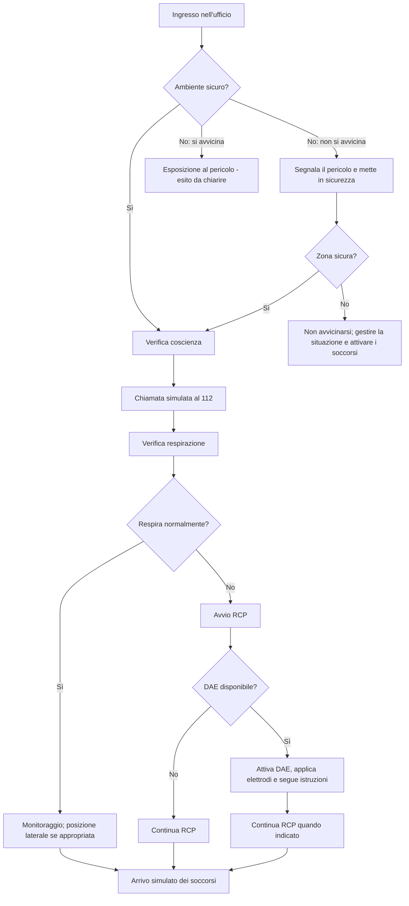

# Sicurezza Immersiva 81 — Specifiche di sviluppo: Man Down

> **Documento di riferimento per OpenCode e per il gruppo di sviluppo.**  
> Scenario 2 — **Man Down (ID 3)** · Unity / C# · VR · OpenXR · target di test: Meta Quest 3.  
> **Stato:** specifica funzionale, **non** attestazione di funzionalità già implementate.

## 1. Fonti, ambito e priorità

Questo documento consolida tre documenti di progetto:

1. **`Man_Down_GDD.pdf`** — GDD specifico dello scenario, fonte primaria per le meccaniche e gli esiti di Man Down.
2. **`FlowChart_ManDown.pdf`** — diagramma dei percorsi decisionali, inclusi il pericolo ambientale e i quattro Bad Ending.
3. **`Project Work VR - GDD.pdf`** — GDD generale di *Sicurezza Immersiva 81*, fonte per difficoltà, interazioni VR, punteggi, accessibilità e sistemi comuni.

In caso di discrepanze, **non inventare una soluzione e non modificare automaticamente il comportamento**: segnala il conflitto e chiedi conferma. Per lo scenario, il GDD specifico è la base funzionale più dettagliata; il flowchart conserva valore come riferimento di flusso. Questo file è un riassunto operativo e non sostituisce i PDF originali.

**Ambito del gruppo:** implementare il solo scenario Man Down e le risorse ad esso necessarie. Menu globali, impostazioni XR, leaderboard, salvataggi e sistemi comuni devono essere **riutilizzati se esistenti**, non duplicati.

## 2. Progetto generale

*Sicurezza Immersiva 81* è un serious game educativo VR single-player per supportare la formazione sulla sicurezza sul lavoro. Il giocatore, in prima persona, esplora ambienti lavorativi, valuta rischi, usa strumenti e prende decisioni durante emergenze. Le azioni ricevono feedback visivo, sonoro e testuale, con esito finale di successo, successo parziale o fallimento.

- **Engine e linguaggio:** Unity e C#.
- **Piattaforma:** OpenXR, visori VR/MR; il gruppo intende testare su Meta Quest 3.
- **Interazione generale:** movimento 6DoF, locomozione lineare e/o teleport, grab/drop, utilizzo strumenti, interazioni UI e digitazione su telefono.
- **Vincolo di integrazione:** identificare prima i componenti XR, prefab, input e scoring già presenti nel progetto. Il GDD **non definisce una mappatura esatta dei pulsanti** dei controller.
- **Accessibilità prevista dal GDD generale:** mano dominante selezionabile; palette distinguibile anche per daltonismo (esempio Okabe–Ito); testi leggibili.

## 3. Obiettivo e situazione iniziale

Il giocatore entra in un ufficio e trova un collega incosciente a terra vicino a una scrivania. Deve verificare la sicurezza dell'ambiente, controllare la coscienza, chiamare il **112**, valutare la respirazione e seguire il percorso appropriato fino all'arrivo simulato dei soccorsi.

All'avvio di una partita si determinano casualmente, e si mantengono stabili durante quella partita:

- **Respirazione dell'NPC:** normale **oppure** assente/non normale.
- **Disponibilità del DAE:** presente **oppure** assente.
- **Opzionale:** presenza di una pozzanghera con rischio di scivolamento.

Le variabili casuali devono essere **indipendenti**, salvo diversa decisione esplicita del gruppo. Non presupporre percentuali di probabilità: devono essere configurabili o concordate.

## 4. Ambientazione e oggetti

| Elemento | Ruolo previsto |
|---|---|
| NPC incosciente a terra | Verifica di coscienza e respirazione; RCP; eventuale cambio posa |
| Scrivania, computer | Arredamento e contesto dell'ufficio |
| Telefono | Chiamata simulata al 112 |
| DAE a parete | Strumento utilizzabile **solo se presente** nella partita |
| Arredamento da ufficio | Ambientazione e navigazione |
| Pozzanghera + panno (**opzionali**) | Rischio ambientale; possibile mitigazione e penalizzazione |

Gli oggetti decorativi non richiedono automaticamente sistemi di interazione o prefab personalizzati. Riutilizzare asset e prefab condivisi come **istanze**, senza modificare gli originali.

## 5. Sequenza funzionale principale

### 5.1 Verifica della sicurezza

1. Il giocatore entra nella stanza.
2. Deve valutare se può avvicinarsi in sicurezza.
3. Se esiste un pericolo, il flowchart prevede la possibilità di **segnalarlo e mettere in sicurezza la zona**, quindi rivalutare.
4. Avvicinarsi nonostante un pericolo grave porta nel flowchart a **Bad Ending: esposizione al pericolo**.
5. Il GDD specifico tratta la **pozzanghera come elemento opzionale** e associa il comportamento imprudente a una **penalizzazione**, non necessariamente a un fallimento immediato. **Non trasformare automaticamente la pozzanghera in morte/fallimento**: vedi §9.

### 5.2 Coscienza e soccorsi

1. Il giocatore interagisce con l'NPC per verificarne lo stato di coscienza.
2. Deve attivare i soccorsi: **chiamata simulata al 112** e attivazione del primo soccorso aziendale, come indicato nel GDD specifico.
3. La mancata chiamata è un errore critico che conduce a un Bad Ending, secondo le condizioni di valutazione da concordare (non fallire istantaneamente soltanto perché l'utente non ha ancora premuto il telefono).
4. Il giocatore controlla la respirazione dell'NPC.

### 5.3 Percorso A — respirazione normale

1. Il sistema comunica l'esito della verifica della respirazione tramite feedback appropriato.
2. Il giocatore monitora l'NPC.
3. **Se appropriato**, può metterlo in posizione laterale: rappresentazione semplificata tramite **cambio di posa** dell'NPC, senza necessità di simulazione fisica complessa.
4. Arrivano i soccorsi in modo simulato e viene valutato l'esito.

### 5.4 Percorso B — respirazione assente o non normale

1. Il giocatore avvia la **RCP**, simulata mediante interazioni ripetute sul torace.
2. Se il **DAE è presente**, il giocatore lo attiva, applica gli elettrodi in modo semplificato e segue le istruzioni audio/visive del dispositivo.
3. Se il **DAE è assente**, continua la RCP in attesa dei soccorsi.
4. Quando indicato, riprende/continua la RCP anche nel percorso con DAE.
5. Arrivano i soccorsi in modo simulato e viene valutato l'esito.

**Nota didattica:** queste sono meccaniche di simulazione tratte dal GDD, non istruzioni cliniche complete né certificazione BLSD. Validare procedure, feedback e terminologia con un formatore qualificato prima di presentarle come formazione sanitaria corretta. Il timer di gioco non deve suggerire che sia appropriato interrompere la rianimazione dopo 2–3 minuti nel mondo reale.

## 6. Flowchart logico normalizzato

Il diagramma rappresenta il **percorso corretto**. I fallimenti e i relativi trigger sono specificati separatamente nel §9. Il nodo “non avvicinarsi / gestire situazione” non è un'autorizzazione a lasciare la persona senza attivare soccorsi: nel flowchart originale la freccia dalla zona non sicura confluisce comunque nel percorso della chiamata.

## 7. Interazioni richieste (versione semplificata)

| Interazione | Comportamento atteso | Vincoli |
|---|---|---|
| Verifica sicurezza | Riconoscere/gestire il rischio | La pozzanghera è opzionale |
| Verifica coscienza | Interazione XR con NPC e feedback | Nessun ragdoll obbligatorio |
| Chiamata 112 | Uso del telefono, risposta simulata | Riutilizzare il sistema di input esistente; il GDD generale prevede digitazione numerica |
| Verifica respirazione | Interazione con NPC e risultato coerente con lo stato estratto | Possibile movimento del torace come indizio visivo |
| Posizione laterale | Sostituzione/cambio posa NPC | Solo quando appropriato |
| RCP | Interazioni ripetute nell'area del torace, con feedback | Non simulare biomeccanica medica complessa |
| DAE | Attivazione, applicazione elettrodi, istruzioni semplificate | Disponibile solo nelle partite che lo prevedono |
| Fine scenario | Arrivo simulato soccorsi e valutazione | Integrare il sistema comune di esiti/punteggi |

**Non imporre nomi di classi, prefab, metodi o un'architettura specifica prima di aver ispezionato il progetto.** Le interazioni devono essere piccole, testabili e integrate con gli strumenti XR già presenti.

## 8. Difficoltà e punteggi (GDD generale)

| Difficoltà | Aiuti e caratteristiche | Tempo Man Down | Successo | Parziale | Fallimento |
|---|---|---:|---:|---:|---:|
| Guidato | Evidenziazione interagibili, suggerimenti, feedback e cronometro | Non specificato nel GDD Man Down | Sistema comune | Sistema comune | Sistema comune |
| Realistico | Niente evidenziazione; timer; sistema comune di salute a 3 cuori dove applicabile | **3 minuti** | **30** | **10** | **0** |
| Stress | Nessun aiuto; possibili disturbi audio/visivi; timer | **2 minuti** | **50** | **20** | **0** |

Il GDD generale include un sistema di salute e schermate di fallimento, ma **non impone** che il Man Down debba simulare danni fisici al giocatore in ogni percorso. Non inventare un tempo per il Guidato. I timer sono limiti **di gameplay**; la gestione di scadenza e feedback va integrata con il sistema comune o concordata.

Esiti comuni:

- **Successo completo:** messaggio di successo, punteggio, incoraggiamento, possibilità di avanzare.
- **Successo parziale:** messaggio, punteggio, riepilogo di azioni corrette/scorrette.
- **Fallimento:** messaggio, punteggio, riepilogo e possibilità di riprovare.

Non implementare autonomamente menu globale, leaderboard, badge o persistenza se sono responsabilità di altri gruppi.

## 9. Errori, Bad Ending e discrepanze tra fonti

**Il flowchart e il GDD specifico numerano diversamente i Bad Ending.** Evitare di codificare la logica basandosi solo sui numeri: utilizzare **identificatori semantici** e concordare la numerazione finale.

| Condizione | Flowchart originale | GDD specifico |
|---|---|---|
| Avvicinamento in ambiente pericoloso | **Bad Ending 1** — esposizione al pericolo | Pozzanghera opzionale: comportamento imprudente → penalizzazione; non elenca un Bad Ending dedicato |
| Mancata chiamata al 112 | **Bad Ending 2** | **Bad Ending 1** |
| Mancata RCP quando necessaria | **Bad Ending 3** | **Bad Ending 2** |
| DAE presente ma ignorato | **Bad Ending 4** | **Bad Ending 3** |
| Errori non critici | Non dettagliati | Penalizzazione e possibile successo parziale |

**Decisioni da confermare prima di implementare:**

1. Se il pericolo ambientale grave deve causare un fallimento immediato e come distinguerlo dalla pozzanghera opzionale.
2. Quale numerazione/etichettatura mostrare al giocatore (consigliato internamente: nomi semantici, non numeri).
3. Quali condizioni temporali o azioni determinano definitivamente “mancata chiamata”, “mancata RCP” o “DAE ignorato”.
4. Se e come assegnare penalità o successo parziale per errori recuperabili.
5. Cosa succede allo scadere del timer e quando mostrare l'arrivo dei soccorsi.

Per evitare bug di flusso, una singola omissione non deve essere valutata prematuramente mentre il giocatore sta ancora eseguendo la procedura, salvo regole esplicitamente approvate.

## 10. Feedback

- **Visivo:** evidenziazioni nella modalità Guidato; movimento del torace dell'NPC; indicatore per le interazioni RCP; cambio posa; feedback su azioni corrette/errate; schermate di esito.
- **Audio:** ambiente, chiamata simulata al 112, istruzioni DAE, conferme ed errori.
- **Testo:** suggerimenti in Guidato, istruzioni essenziali e riepilogo finale delle azioni.
- **Accessibilità:** non affidare informazioni critiche solo al colore o solo all'audio; mantenere leggibilità in VR, coerentemente con le linee guida generali.

## 11. Integrazione tecnica e confini del gruppo

Queste sono **direttive operative per OpenCode**, non descrizioni di sistemi già verificati:

1. All'inizio di ogni task, leggere **`AGENTS.md`** (se presente) e questo documento, quindi verificare lo stato reale di scene, prefab e script.
2. Lavorare soltanto nella directory del gruppo, indicativamente `Assets/_Project/Groups/G_Marius/` e relative sottocartelle; confermare il percorso effettivo nel progetto.
3. **Non modificare** `Shared`, cartelle di altri gruppi, `ProjectSettings`, `Packages`, configurazioni XR o scene globali senza autorizzazione.
4. I prefab condivisi possono essere **istanziati** nelle scene del gruppo; non applicare modifiche agli asset sorgente.
5. Non duplicare XR Origin, locomozione, input, scoring o UI se già esistenti.
6. Non introdurre nuovi pacchetti, sistemi complessi o dipendenze non necessarie.
7. Preferire meccaniche robuste e semplici: cambio posa invece di ragdoll, RCP tramite interazioni ripetute, DAE con procedura semplificata.
8. Suddividere il lavoro in task piccoli, verificabili in Unity e possibilmente sul visore.
9. Alla fine di ogni task, registrare in `AGENTS.md` **solo** file realmente creati/modificati, comportamento implementato, verifiche eseguite e problemi aperti. **Non segnare come completato ciò che non è stato testato.**
10. Per ogni task indicare prima file e prefab coinvolti; chiedere conferma per modifiche con impatto esterno alla directory autorizzata.

### Nomenclatura richiesta dal gruppo

- Materiali: `MAT_NomeOggetto`, ad esempio `MAT_OfficeChair_Fabric`.
- Prefab: `PFB_NomeOggetto`.
- Texture: `TEX_NomeOggetto_Tipo` per i nuovi asset, senza rinominare file importati se rischia di rompere riferimenti.
- Scene: `SCN_NomeScena`.
- Script/classi C#: `PascalCase`; campi privati `camelCase`.

## 12. Checklist funzionale per test e accettazione

- [ ] La scena si apre senza errori e utilizza l'infrastruttura XR prevista dal progetto.
- [ ] All'avvio sono selezionati uno stato di respirazione e una disponibilità DAE coerenti e stabili per tutta la partita.
- [ ] Si può verificare lo stato di coscienza dell'NPC.
- [ ] È possibile effettuare la chiamata simulata al 112.
- [ ] La verifica della respirazione porta al ramo corretto.
- [ ] Nel ramo “respira” funzionano monitoraggio ed eventuale cambio posa, se appropriato.
- [ ] Nel ramo “non respira normalmente” si può eseguire la RCP con interazioni ripetute.
- [ ] Se il DAE è presente, la procedura semplificata è utilizzabile e fornisce istruzioni.
- [ ] Se il DAE è assente, la procedura permette di continuare la RCP senza bloccarsi.
- [ ] La chiamata omessa, la RCP omessa e il DAE ignorato vengono valutati secondo regole esplicitamente approvate.
- [ ] La pozzanghera, se implementata, non provoca automaticamente un fallimento contrario al GDD specifico.
- [ ] I timer Realistico (3:00) e Stress (2:00) funzionano secondo le regole concordate.
- [ ] Gli esiti finale completo/parziale/fallimento e i punteggi usano il sistema condiviso, se disponibile.
- [ ] Le istruzioni e i feedback non sono limitati esclusivamente a colore o audio.
- [ ] Nessun asset Shared, di altri gruppi o impostazione globale è stato modificato.
- [ ] La scena è stata provata in Play Mode e, quando possibile, su Meta Quest 3.

## 13. Questioni aperte e priorità

**Questioni aperte:** discrepanza sulla numerazione dei Bad Ending; gestione del pericolo ambientale; durata Guidato; condizioni di timeout; criterio di completamento della RCP/DAE; disponibilità e interfacce reali dei sistemi condivisi; probabilità di randomizzazione. Queste questioni **non sono requisiti già risolti**.

**Priorità consigliata di sviluppo (proposta tecnica, non ordine imposto dai GDD):**

1. Ispezionare scene e sistemi Shared in sola lettura; definire punti di integrazione.
2. Allestire l'ufficio e collocare NPC, telefono e DAE.
3. Gestire stato di scenario e randomizzazione.
4. Implementare verifica coscienza e chiamata 112.
5. Implementare verifica respirazione e due rami.
6. Implementare cambio posa/monitoraggio e RCP.
7. Implementare DAE opzionale.
8. Integrare feedback, difficoltà, esiti e scoring condiviso.
9. Aggiungere, se resta tempo, pozzanghera e rifiniture audiovisive.

---

**Istruzione per OpenCode:** prima di scrivere codice, confronta queste specifiche con il progetto Unity reale e con i PDF originali. Riporta eventuali discrepanze, proponi un singolo task circoscritto e attendi conferma quando una scelta non è definita. Questo documento **non prova** che una funzionalità esista già.
