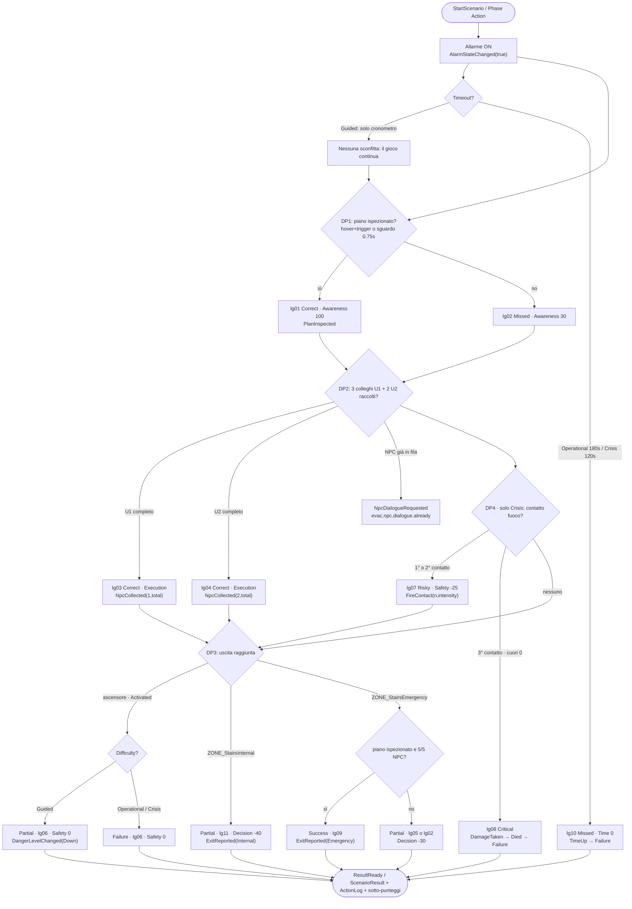
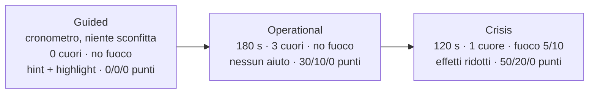

# EVACUATION — Flowchart decisioni, conseguenze, eventi, esiti

Legenda: ogni nodo riporta la conseguenza di gameplay, l'ID di log e/o l'evento C# emesso.
Il debrief associato è in `EVAC_DEBRIEF_TABLE.md`; la superficie del Director è in `EVAC_TECHNICAL_DOCS.md`.

## Flusso principale

## I tre livelli

Note:

- In Guided l'ascensore **non** è sconfitta: evento di pericolo `Down` + `evac.lg06`, esito massimo `Partial`.
- In Operational/Crisis l'ascensore è `Failure` immediato (basta premere il pulsante, non serve entrare).
- Il timer non sconfigge mai in Guided; `TimeUp` e `evac.lg10` sono emessi solo negli altri due livelli.
- Il fuoco esiste solo in Crisis; i contatti sono un contatore separato dai cuori, con cooldown di 2 s sullo stesso ingresso.
- A ogni run `ReplayStarted(seed, slot NPC, slot fuoco)` e `evac.replay.start` nel log: posizione NPC e focolai cambiano col seed.
- `ResetScenario()` riporta tutto allo stato iniziale e teletrasporta il rig a `SPAWN_Player`; nessuno stato statico sopravvive.
