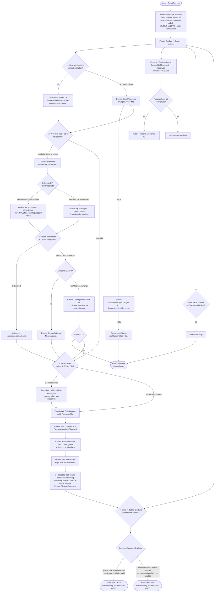

# Chemical Alert — Documentazione Tecnica (Gruppo Tiziano)

Scenario VR **Chemical Alert** per *Sicurezza Immersiva 81* (Unity 6000.3, URP, OpenXR, Meta XR Core SDK, target Meta Quest 3).
Tutti i file del gruppo risiedono in `Assets/_Project/Groups/G_Tiziano/` (`GROUP/`).

---

## 1. Architettura e Confine Esterno (`ChemicalAlertDirector`)

Il gameplay è isolato dietro un unico punto di confine verso l'esterno: **`ChemicalAlertDirector`** (`SI81.Tiziano.ChemicalAlert.Systems.ChemicalAlertDirector`).
- **Nessuna UI e nessuna animazione** sono cablate nella logica: ogni feedback verso giocatore, HUD, sottotitoli o schermata di recap avviene tramite **stato leggibile**, **eventi C#** e log in console con prefisso `[CA]`.
- **Visual separato dalla logica:** ogni oggetto di scena mantiene collider, rigidbody e script sulla root e delega la rappresentazione 3D al figlio `Visual`. Dove in futuro potrà essere collegata un'animazione, i componenti espongono `UnityEvent` (`OnTurnedOn`, `OnOpened`, `OnClosed`, `OnGrabbed`, `OnReleased`, `OnActivated`, `OnInspected`, `OnHoverEnter`, `OnHoverExit`).
- **Input provvisorio centralizzato:** solo `ScenarioInputBindings` interroga `OVRInput` (controller `LTouch` e `RTouch`). Quando verrà integrata la Interaction Library comune, basterà sostituire lo strato `ScenarioInputBindings` / `ScenarioHandInteractor` mantenendo invariata la superficie `ScenarioInteractable`.
- **Reset deterministico (`IResettable`):** ogni sistema di scenario implementa `IResettable.ResetState()` o si riallinea sull'evento `PhaseChanged(Phase.Briefing)` emesso da `ChemicalAlertDirector.ResetScenario()`.

---

## 2. Stato ed Eventi Esposti dal Director per la UI Futura

### 2.1 Enumerazioni Pubbliche
| Enum | Valori | Descrizione |
|---|---|---|
| `ChemicalAlertDirector.Difficulty` | `Guided`, `Operational`, `Crisis` | Livello di difficoltà attivo (Guidato / Realistico / Stress). |
| `ChemicalAlertDirector.Phase` | `Briefing`, `Scan`, `Action`, `Resolution`, `ResultHandoff` | Fase corrente dello scenario. |
| `ChemicalAlertDirector.DangerLevel` | `Down`, `Mid`, `Up` | Livello sintetico di pericolo ambientale/ventilazione per HUD Guided. |
| `Outcome` (`Core`) | `Success`, `Partial`, `Failure` | Esito finale della missione. |
| `Dimension` (`Core`) | `Safety`, `Awareness`, `Decision`, `Execution`, `Time` | Le 5 dimensioni di valutazione (sotto-punteggi `0–100`). |

### 2.2 Proprietà Leggibili su `ChemicalAlertDirector`
| Proprietà | Tipo | Descrizione |
|---|---|---|
| `CurrentPhase` | `Phase` | Fase attuale dello scenario. |
| `TimeRemaining` | `float` | Secondi rimanenti nella fase `Action` (parte da `CurrentConfig.TotalDurationSeconds`, default `180s`). |
| `Hearts` | `int` | Cuori iniziali/correnti configurati dal livello (`0` in Guided, `3` in Operational/Crisis). I cuori runtime aggiornati dopo i danni sono esposti anche da `PlayerHealth.Hearts`. |
| `SelectedDifficulty` | `Difficulty` | Difficoltà selezionata (`Guided`, `Operational`, `Crisis`). |
| `CurrentConfig` | `ChemicalAlertConfig` | ScriptableObject di configurazione attivo per la difficoltà corrente. |
| `Outcome` | `Outcome?` | Esito finale (`null` finché la partita è in corso). |
| `ActionLog` | `ActionLog` | Registro cronologico delle azioni significative (`Entries`, `Count`). |
| `LastResult` | `ScenarioResult` | Ultimo risultato calcolato (`Outcome`, `SubScores`, `ActionLog`). |
| `CurrentDangerLevel` | `DangerLevel` | Stato pericolo ventilazione (`Down` → `Mid` alla tosse/inizio fase tossica → `Up` oltre il 50% della fase tossica o in `Loss`). |
| `EmittedHintCount` | `int` | Numero di hint ordinati già emessi in modalità `Guided`. |
| `ReducedEffects` | `bool` | Flag di accessibilità per ridurre intensità/frequenza dei disturbi in modalità `Crisis`. |

### 2.3 Eventi C# per UI, Audio e Game System
| Componente | Evento C# | Firma | Quando viene emesso |
|---|---|---|---|
| `ChemicalAlertDirector` | `PhaseChanged` | `Action<Phase>` | A ogni cambio di fase e al reset (`Phase.Briefing`). |
| `ChemicalAlertDirector` | `TimeUp` | `Action` | Quando il timer raggiunge `0` con `DefeatOnTimeout == true` (Operational/Crisis). |
| `ChemicalAlertDirector` | `ResultReady` | `Action<ScenarioResult>` | A fine missione (`Phase.ResultHandoff`), con `Outcome`, sotto-punteggi `0–100` e `ActionLog`. |
| `ChemicalAlertDirector` | `SecondSpillOccurred` | `Action` | Quando scatta l'evento dinamico "seconda perdita" nella finestra `20–40s` di `Action`. |
| `ChemicalAlertDirector` | `HintRequested` | `Action<string>` | In `Guided`, dopo `HintIdleSeconds` (`20s`) senza progressi o su richiesta manuale (`Button.One` / tasto `8`), passando la chiave di localizzazione (`chemical.hint.*`). |
| `ChemicalAlertDirector` | `DangerLevelChanged` | `Action<DangerLevel>` | Quando il livello di pericolo ambientale cambia tra `Down`, `Mid` e `Up`. |
| `PlayerHealth` | `DamageTaken` | `Action<string, float>` | Danno subito in Operational/Crisis (`kind = "burn"`, `durationSeconds = 5f`). |
| `PlayerHealth` | `DangerDetected` | `Action<string, float>` | Contatto pericoloso in `Guided` (nessun danno/morte, solo segnalazione per feedback UI). |
| `PlayerHealth` | `Died` | `Action` | Cuori scesi a `0` in Operational/Crisis (porta il Director a `Outcome.Failure`). |
| `VentilationEscalation` | `CoughTriggered` | `Action` | Superata la soglia nascosta di tosse (`40s ± jitter` senza ventilazione). |
| `VentilationEscalation` | `VentilationStageChanged` | `Action<float>` | Avanzamento progressivo `0..1` della fase tossica (per vignetta verde/VFX futuri). |
| `VentilationEscalation` | `LossStarted` | `Action` | Superata la soglia di sconfitta per mancata ventilazione (`80s ± jitter`). |
| `SdsItem` | `SdsRead` | `Action<SubstanceVariant>` | Prima ispezione della SDS vicino al visore (`CurrentVariant` con chiavi titolo/corpo e DPI richiesti). |
| `Puddle` | `ContainedChanged` | `Action<bool>` | Quando il perimetro di 6 salsicciotti blocca l'espansione della pozzanghera. |
| `CleanupSystem` | `CleanupComplete` | `Action` | Quando tutti i fogli assorbenti richiesti sono stati posati sulla pozzanghera e smaltiti in `WasteBag`. |

### 2.4 Catalogo Chiavi di Localizzazione e `ActionLog`
Nessuna stringa utente è hardcoded in italiano nel codice; vengono emesse solo chiavi stabili:
- **SDS (`SubstanceVariant`):**
  - `variantA`: `chemical.sds.variantA.title`, `chemical.sds.variantA.body`
  - `variantB`: `chemical.sds.variantB.title`, `chemical.sds.variantB.body`
  - `variantC`: `chemical.sds.variantC.title`, `chemical.sds.variantC.body`
- **DPI (`PPEItem.TextKey`):**
  - Corretti: `chemical.ppe.gloves`, `chemical.ppe.sealedGoggles`, `chemical.ppe.apron`, `chemical.ppe.respirator`, `chemical.ppe.suit`, `chemical.ppe.faceShield`
  - Decoy/errati: `chemical.ppe.workGloves`, `chemical.ppe.safetyGlasses`, `chemical.ppe.simpleMask`
- **Hint ordinati (`HintSO.LocalizationKey`):**
  1. `chemical.hint.ventilation` (`stepId = ventilation`)
  2. `chemical.hint.sds` (`stepId = sds`)
  3. `chemical.hint.ppe` (`stepId = ppe`)
  4. `chemical.hint.perimeter` (`stepId = spill.perimeter`)
  5. `chemical.hint.cleanup` (`stepId = cleanup`)
- **Voci registrate in `ActionLog` (`ActionId` → `Dimension` → `ConsequenceKey`):**
  - `sds.inspect` (` isCorrect = true`, `Awareness`, `chemical.sds.read`)
  - `ppe.equip.<Slot>` (`isCorrect = !isDecoy`, `Decision`, `chemical.ppe.equipped` | `chemical.ppe.decoy`)
  - `ppe.slot.<Slot>` (`isCorrect = true`, `Safety`, `chemical.ppe.slot`)
  - `substance.contact.safe` (`isCorrect = true`, `Safety`, `chemical.contact.safe`)
  - `substance.contact` (`isCorrect = false`, `Safety`, `chemical.burn`)
  - `health.damage` (`isCorrect = false`, `Safety`, `chemical.burn`)
  - `spillkit.before-procedure` (`isCorrect = false`, `Decision`, `chemical.order.spillkit-early`)
  - `sheet.place` (`isCorrect = true`, `Execution`, `chemical.sheet.place`)
  - `waste.collect` (`isCorrect = safe`, `Execution`, `chemical.waste.collect` | `chemical.burn`)
  - `waste.dispose` (`isCorrect = true`, `Execution`, `chemical.waste.disposed`)
  - `event.second_spill` (`isCorrect = true`, `Awareness`, `chemical.spill.second`)
  - `exit.safe` (`isCorrect = true`, `Decision`, `exit.safe`)

---

## 3. Flowchart Mermaid (Decisioni, Conseguenze, Eventi ed Esiti)

---

## 4. Script C# (`GROUP/Code/Scripts/`)

Tutti gli script appartengono al namespace radice `SI81.Tiziano.ChemicalAlert` (senza `.asmdef` per compilare nell'assembly principale insieme agli altri gruppi senza collisioni di nomi).

### 4.1 `Core/` (`SI81.Tiziano.ChemicalAlert.Core`)
- **`IResettable.cs`** — Interfaccia con `void ResetState()` implementata dai sistemi resettabili dello scenario.
- **`Dimension.cs`** — Enum delle 5 dimensioni di valutazione: `Safety`, `Awareness`, `Decision`, `Execution`, `Time`.
- **`ActionLog.cs`** — Classi `ActionLogEntry` (`Timestamp`, `ActionId`, `IsCorrect`, `Dimension`, `ConsequenceKey`) e `ActionLog` (`Add`, `Clear`, `Entries`, `Count`).
- **`ScenarioResult.cs`** — Risultato immutabile con `Outcome` (`Success`, `Partial`, `Failure`), `ActionLog`, dizionario `SubScores` (`0–100` per ciascuna `Dimension`) e `GetSubScore(Dimension)`.
- **`OutcomeEvaluator.cs`** — Regole pure di valutazione (`Evaluate`) e suite di auto-verifica deterministica a 9 casi (`SelfCheck`, invocabile col comando `O`).

### 4.2 `Data/` (`SI81.Tiziano.ChemicalAlert.Data`)
- **`ChemicalAlertConfig.cs`** — `ScriptableObject` di configurazione per difficoltà (`DifficultyId`, `TotalDurationSeconds`, `VentilationCoughThresholdSeconds`, `VentilationToxicStageDelaySeconds`, `VentilationFailureDelaySeconds`, `VentilationJitterSeconds`, `Hearts`, `PainDurationSeconds`, `HintsEnabled`, `DistractionsEnabled`, `GuidedHighlights`, `OrderedHints`, `HintIdleSeconds`, `DisturbanceEnabled`, `DisturbanceFrequencyHz` clampato `0.1..3 Hz`, `SubstanceVariants`, `PpeShufflePool`, `SecondSpillEnabled`, `SecondSpillWindowStartSeconds`, `SecondSpillWindowEndSeconds`, `SecondSpillGrowthMultiplier`, `SecondSpillAudio`, `DefeatOnTimeout`, `SuccessPoints`, `PartialPoints`, `FailurePoints`).
- **`SubstanceVariant.cs`** — `ScriptableObject` per variante chimica (`VariantId`, `SdsTitleKey`, `SdsBodyKey`, `RequiredPpe`, `GrowthRate`, `MaxRadius`, `PuddleColor`).
- **`PPEItem.cs`** — `ScriptableObject` per singolo DPI (`ItemId`, `TextKey`, `EquipmentSlot` ∈ `{Head, Torso, Hands}`, `IsDecoy`).
- **`HintSO.cs`** — `ScriptableObject` per hint guidato ordinato (`StepId`, `LocalizationKey`).

### 4.3 `Interaction/` (`SI81.Tiziano.ChemicalAlert.Interaction`)
- **`ScenarioInputBindings.cs`** — Unico punto di lettura `OVRInput`:
  - `GetGripDown(controller)` / `GetGripUp(controller)` → `OVRInput.Button.PrimaryHandTrigger`
  - `GetTriggerDown(controller)` → `OVRInput.Button.PrimaryIndexTrigger`
  - `GetHintDown(controller)` → `OVRInput.Button.One` (pulsante A su `RTouch` / X su `LTouch`)
- **`ScenarioHandInteractor.cs`** — Interattore near-controller su `LeftControllerAnchor` (`LTouch`) e `RightControllerAnchor` (`RTouch`): rileva il `ScenarioInteractable` più vicino entro `hoverRadius = 0.12m`, gestisce Grab/Release con parenting e velocità di rilascio, Activate con Trigger e Inspect automatico quando l'oggetto afferrato è portato entro `inspectDistance = 0.35m` davanti a `CenterEyeAnchor` (`headAnchor`).
- **`ScenarioInteractable.cs`** — Superficie d'interazione sugli oggetti dello scenario (`Grabbable`, `Activatable`, `Inspectable`), eventi C# + `UnityEvent` e highlight emissivo pulsante `#E69F00` via `MaterialPropertyBlock` (`SetGuidedHighlight(bool)`), attivo solo in modalità `Guided`.
- **`VentTerminal.cs`** — Terminale su `VentilationButton`; all'attivazione (`ScenarioInteractable.Activated` o `TurnOn()`) emette `TurnedOn` e `OnTurnedOn`.
- **`SdsItem.cs`** — Scheda di sicurezza afferrabile e ispezionabile (`SDSItem`); all'ispezione emette `SdsRead(CurrentVariant)` e registra `sds.inspect`. Supporta `SetVariant(SubstanceVariant)` per il replay e `ResetState()` sull'ancora `POS_SDS`.
- **`PPECabinet.cs`** — Armadietto DPI (`Open`, `Close`, `Toggle`, `ResetCabinet`) con `UnityEvent` `OnOpened` / `OnClosed`.
- **`PPEItemObject.cs`** — Oggetto fisico DPI in scena; al rilascio invoca `TryAutoEquip()` sulle `PPEEquipZone` compatibili. Supporta `SetItemData(PPEItem)` per il rimescolamento dell'armadietto a ogni replay.
- **`SpillKit.cs`** — Contenitore kit antisversamento (`Open`, `Close`, `Toggle`, `ResetKit`) con `UnityEvent` `OnOpened` / `OnClosed`.
- **`SpillSausage.cs`** — Salsicciotto assorbente afferrabile (`SpillSausage_0..5`); al rilascio vicino a un `PerimeterSlot` libero si aggancia al perimetro.
- **`AbsorbentSheet.cs`** — Foglio assorbente afferrabile (`AbsorbentSheet_0..5`); al rilascio sulla pozzanghera contenuta si posiziona tramite `CleanupSystem`.
- **`ExitSafeZone.cs`** — Trigger `ZONE_ExitSafe` accanto alla porta di servizio Est; all'ingresso del giocatore (o `ForceExit()`) notifica `ChemicalAlertDirector.HandleExitSafe()`.

### 4.4 `Systems/` (`SI81.Tiziano.ChemicalAlert.Systems`)
- **`ChemicalAlertDirector.cs`** — Regista centrale dello scenario, timer, fasi, difficoltà, stato pericolo, hint Guided, registrazione `SecondSpillOccurred` e calcolo `ScenarioResult`.
- **`VentilationSystem.cs`** — Stato `Off`/`On` della ventilazione; all'accensione del `VentTerminal` ferma `VentilationEscalation`.
- **`VentilationEscalation.cs`** — Escalation nascosta dell'aria viziata in `Action` quando la ventilazione è spenta (`Inactive` → `Cough` a `40s ± jitter` → `Toxic` a `+20s` → `Loss` a `+20s`), con generatore deterministico `SetRandomSeed(int)`.
- **`PlayerPPEState.cs`** — Aggrega le 3 `PPEEquipZone` (`Head`, `Torso`, `Hands`) sul rig e verifica `HasRequiredSet(SubstanceVariant)` (tutti i DPI richiesti equipaggiati e nessun decoy).
- **`PPEEquipZone.cs`** — Zona trigger sul rig (`PPEEquipZone_Head`, `PPEEquipZone_Torso`, `PPEEquipZone_Hands`, `snapDistance = 0.35m`) che aggancia i `PPEItemObject` compatibili e registra l'azione in `ActionLog`.
- **`Puddle.cs`** — Crescita radiale della pozzanghera in `Action`, applicazione colore variante via `MaterialPropertyBlock`, blocco crescita a perimetro completo (`SetContained`), occultamento a copertura completata (`SetCovered`) e accelerazione crescita `TriggerSecondSpill(multiplier)`.
- **`SubstanceContactSensor.cs`** — Sensore trigger sulla pozzanghera; se toccata da giocatore/mani senza il set DPI richiesto dalla variante corrente, infligge danno scottatura (`PlayerHealth.TakeDamage("burn", 5f)`) o segnala pericolo in `Guided`.
- **`PlayerHealth.cs`** — Gestione cuori, finestra di invulnerabilità (`1s`), danno/morte in Operational/Crisis e sola notifica `DangerDetected` in `Guided`.
- **`PerimeterSlot.cs` & `PerimeterSlots.cs`** — Gestione dei 6 slot perimetrali attorno alla pozzanghera; quando tutti e 6 sono occupati chiama `Puddle.SetContained(true)` e verifica l'eventuale errore di ordine (`spillkit.before-procedure`).
- **`CleanupSystem.cs`** — Gestione copertura pozzanghera con i fogli assorbenti (`requiredSheets = 3` di default), trasformazione dei fogli usati in `WasteItem` e completamento bonifica (`CleanupComplete`) quando tutti i fogli posati sono smaltiti in `WasteBag`.
- **`WasteItem.cs` & `WasteBag.cs`** — Gestione raccolta fogli contaminati (con controllo DPI: raccoglierli senza DPI corretti causa scottatura `burn`) e smaltimento nel contenitore rifiuti pericolosi (`WasteBag`, `snapDistance = 0.65m`).
- **`DisturbanceController.cs`** — Disturbo visivo/audio per modalità `Crisis`: sfarfallio della luce direzionale di scena con frequenza clampata a **`≤ 3 Hz`** (`2.5 Hz` default, dimezzata a `1.25 Hz` con `ReducedEffects = true`) e audio loop opzionale.
- **`ScenarioReplayController.cs`** — Gestione replay e variabilità (T16): seed casuale o fisso (`SetFixedSeed` / `ClearFixedSeed`), selezione `SubstanceVariant` senza ripetizioni consecutive in modalità random, rimescolamento Fisher-Yates dei 9 slot `PPEItemObject`, seed deterministico per il jitter ventilazione e programmazione dell'evento dinamico "seconda perdita" nella finestra `20–40s` di `Action`.

### 4.5 `Debug/` (`SI81.Tiziano.ChemicalAlert.Debug`)
- **`DebugCommands.cs`** — Registro comandi da tastiera (New Input System `Keyboard.current`, attivo in `#if UNITY_EDITOR || DEVELOPMENT_BUILD`) + voci `ContextMenu` sull'Inspector di `OVRCameraRig`, incluso `RunSmokeTest` (`7`).

---

## 5. Prefab, Oggetti di Scena, Trigger e Asset

### 5.1 Scena e Prefab (`GROUP/Level/`)
- **Scena:** `Level/Scenes/SCN_ChemicalAlert.unity`
- **Prefab manager:** `Level/Prefabs/MNG_ChemicalAlertDirector.prefab` (istanziato in scena con `ChemicalAlertDirector`, `VentilationEscalation`, `VentilationSystem`, `PlayerHealth`, `DisturbanceController`, `ScenarioReplayController`).

### 5.2 Trigger, Zone e Marker in `SCN_ChemicalAlert.unity`
| Oggetto | Componenti / Ruolo | Posizione / Note |
|---|---|---|
| `OVRCameraRig` | `OVRCameraRig`, `OVRManager`, `ScenarioInputBindings`, `DebugCommands`, `PlayerPPEState` | Rig XR principale con `LeftControllerAnchor` e `RightControllerAnchor` (`ScenarioHandInteractor`). |
| `PPEEquipZone_Head` / `Torso` / `Hands` | `SphereCollider (isTrigger)`, `PPEEquipZone` | Figli di `OVRCameraRig`; zone di aggancio per i 3 slot DPI. |
| `Puddle` | `BoxCollider (isTrigger)`, `Puddle`, `SubstanceContactSensor` | Pozzanghera centrale (`(0, 0.03, 0)`), espandibile fino a `MaxRadius`. |
| `PerimeterSlots` (`PerimeterSlot_0..5`) | `SphereCollider (isTrigger)`, `PerimeterSlot` | 6 slot esagonali attorno a `Puddle` per i `SpillSausage_0..5`. |
| `ZONE_ExitSafe` | `BoxCollider (isTrigger)`, `ExitSafeZone` | Zona d'uscita sicura presso `ServiceDoor` sulla parete Est (`(5.30, 1.00, 0.00)`). |
| `ZONE_SpillArea` | `BoxCollider` | Volume di riferimento dell'area di sversamento centrale (`(0, 1, 0)`). |
| Marker `SPAWN_Player` e `POS_*` | `Transform` | `SPAWN_Player`, `POS_Barrel`, `POS_Puddle`, `POS_VentButton`, `POS_Truck`, `POS_SDS`, `POS_PPECabinet`, `POS_SpillKit`, `POS_WasteBag` (usati da reset e teletrasporto `T`). |

### 5.3 Asset ScriptableObject (`GROUP/Code/Scripts/Data/Assets/`)
- **Configurazioni difficoltà:**
  - `SO_ChemicalAlertConfig_Guided.asset` (`hearts=0`, `defeatOnTimeout=false`, `hintsEnabled=true`, `guidedHighlights=true`, `distractionsEnabled=false`, `disturbanceEnabled=false`, `secondSpillEnabled=true`)
  - `SO_ChemicalAlertConfig_Operational.asset` (`hearts=3`, `defeatOnTimeout=true`, `ventilationJitter=2s`, `distractionsEnabled=true`, `secondSpillEnabled=true`, punti `30/10/0`)
  - `SO_ChemicalAlertConfig_Crisis.asset` (`hearts=3`, `defeatOnTimeout=true`, `ventilationJitter=4s`, `disturbanceEnabled=true`, `disturbanceFrequencyHz=2.5`, `secondSpillEnabled=true`, punti `50/20/0`)
- **Varianti sostanza (`Substances/`):**
  - `SubstanceVariant_A.asset` (`variantA`, giallo/ambra, `growthRate=0.04`, `maxRadius=1.5`, DPI: `ChemicalGloves + SealedGoggles + ChemicalApron`)
  - `SubstanceVariant_B.asset` (`variantB`, verde, `growthRate=0.06`, `maxRadius=1.8`, DPI: `ChemicalGloves + Respirator + ChemicalSuit`)
  - `SubstanceVariant_C.asset` (`variantC`, blu, `growthRate=0.08`, `maxRadius=2.1`, DPI: `ChemicalGloves + FaceShield + ChemicalApron`)
- **DPI (`PPE/`):**
  - Corretti (6): `PPE_ChemicalGloves`, `PPE_ChemicalApron`, `PPE_ChemicalSuit`, `PPE_SealedGoggles`, `PPE_Respirator`, `PPE_FaceShield`
  - Decoy (3): `PPE_WorkGloves` (Hands), `PPE_SafetyGlasses` (Head), `PPE_SimpleMask` (Head)
- **Hint (`SO_Hint_*`):** `SO_Hint_Ventilation`, `SO_Hint_SDS`, `SO_Hint_PPE`, `SO_Hint_Perimeter`, `SO_Hint_Cleanup`.

### 5.4 Modelli 3D (`Assets/_Project/Shared/Level/Prefabs/`) e Materiali (`GROUP/Art/Materials/`)
I modelli FBX restano in `Assets/_Project/Shared/Level/Prefabs/` e sono istanziati nei figli `Visual` della scena `SCN_ChemicalAlert.unity`:
- `Chemical_Alert_Room/MESH_STANZA_FINESTRE.fbx` + `MESH_FINESTRE_DA_2_TEAM.fbx` + `MESH_FINESTRE_DA_3_TEAM.fbx` → Stanza industriale e lucernari (`Floor > Visual`).
- `MESH_CAMION_PIENO_TEAM.fbx` → Camion nella porta garage Nord (`Truck > Visual`).
- `MESH_RACCOGLITORE_TEAM.fbx` → Raccoglitore SDS sul pianale del camion (`SDSItem > Visual`) e prop sull'armadietto DPI.
- `MESH_VENTOLA_TEAM.fbx` → 2 ventole industriali sulle pareti laterali (`Floor > Visual`).
- `MESH_BARILE_ORO_TEAM.fbx`, `MESH_BARILE_VERDE_ACQUA_TEAM.fbx`, `MESH_BARILE_BLU_TEAM.fbx` → Barile centrale rovesciato (`Barrel > Visual`), contenitore rifiuti con coperchio aperto (`WasteBag > Visual`), scaffalature a 3 ripiani (`Shelf_Left`, `Shelf_Right`) e pallet di scarico.
- `MESH_SCATOLA_APRIBILE_TEAM.fbx`, `MESH_SCATOLA_APRIBILE_VERDE_TEAM.fbx`, `MESH_SCATOLA_APRIBILE_ROSSA_TEAM.fbx` → Scatole sul banco `SpillKit`, su `PPECabinet` e sulle scaffalature laterali.
- `MESH_SODA_CAUSTICA_TEAM.fbx` → Contenitori chimici vicino alla perdita centrale e sui ripiani degli scaffali.
- Materiali URP del gruppo (`GROUP/Art/Materials/`): `MAT_Graybox.mat`, `MAT_Hazard.mat`, `MAT_Safety.mat`, `MAT_BoxRed.mat`, `MAT_BoxGreen.mat`, `MAT_BoxCardboard.mat`, `MAT_SteelDark.mat`, `MAT_ShelfBeam.mat`, `MAT_ShelfDeck.mat`.
