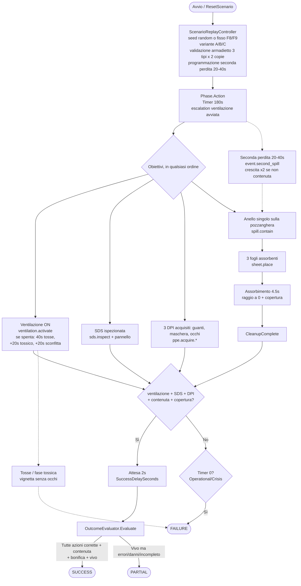

# Chemical Alert — Documentazione Tecnica (Gruppo Tiziano)

Scenario VR **Chemical Alert** per *Sicurezza Immersiva 81* (Unity 6000.3, URP, OpenXR, Meta XR Core SDK, target Meta Quest 3).
Tutti i file del gruppo risiedono in `Assets/_Project/Groups/G_Tiziano/` (`GROUP/`).

**Ultimo aggiornamento:** 2026-11-24 (regole a ordine libero, 3 DPI × 2 copie, anello singolo, 3 fogli, esito automatico).

---

## 1. Architettura e Confine Esterno (`ChemicalAlertDirector`)

Il gameplay è isolato dietro un unico punto di confine verso l'esterno: **`ChemicalAlertDirector`** (`SI81.Tiziano.ChemicalAlert.Systems.ChemicalAlertDirector`).
- **Nessuna UI di esito e nessuna animazione** sono cablate nella logica: ogni feedback verso giocatore, HUD, sottotitoli o schermata di recap avviene tramite **stato leggibile**, **eventi C#** e log in console con prefisso `[CA]`.
- **Eccezione concordata:** `ChemicalAlertPanelUI` implementa il pannello SDS statico, i popup errore, la vignetta tossica e il cue di tosse, perché servono alla verifica del gameplay. Restano fuori HUD, menu, recap e schermata di vittoria.
- **Visual separato dalla logica:** ogni oggetto di scena mantiene collider, rigidbody e script sulla root e delega la rappresentazione 3D al figlio `Visual`. I componenti espongono `UnityEvent` (`OnTurnedOn`, `OnOpened`, `OnClosed`) per le animazioni future.
- **Input provvisorio centralizzato:** solo `ScenarioInputBindings` interroga `OVRInput` (controller `LTouch` e `RTouch`). Sostituendo `ScenarioInputBindings` / `ScenarioHandInteractor` con la Interaction Library comune resta invariata la superficie `ScenarioInteractable`.
- **Reset deterministico (`IResettable`):** ogni sistema implementa `IResettable.ResetState()` e si riallinea sull'evento `PhaseChanged(Phase.Briefing)` emesso da `ChemicalAlertDirector.ResetScenario()`.
- **Avvio partita:** `ResetScenario()` imposta `Briefing`, emette `PhaseChanged(Briefing)` (che resetta i sistemi) e poi porta subito la partita in `Phase.Action`. `Scan` esiste ancora nell'enum ma non è usato dal flusso automatico.

---

## 2. Stato ed Eventi Esposti dal Director per la UI Futura

### 2.1 Enumerazioni Pubbliche
| Enum | Valori | Descrizione |
|---|---|---|
| `ChemicalAlertDirector.Difficulty` | `Guided`, `Operational`, `Crisis` | Livello di difficoltà attivo (Guidato / Realistico / Stress). |
| `ChemicalAlertDirector.Phase` | `Briefing`, `Scan`, `Action`, `Resolution`, `ResultHandoff` | Fase corrente. Il flusso automatico usa `Briefing` → `Action` → `Resolution` → `ResultHandoff`. |
| `ChemicalAlertDirector.DangerLevel` | `Down`, `Mid`, `Up` | Livello sintetico di pericolo ambientale per HUD Guided. |
| `Outcome` (`Core`) | `Success`, `Partial`, `Failure` | Esito finale della missione. |
| `Dimension` (`Core`) | `Safety`, `Awareness`, `Decision`, `Execution`, `Time` | Le 5 dimensioni di valutazione (sotto-punteggi `0–100`). |
| `VentilationEscalation.Stage` | `Inactive`, `Cough`, `Toxic`, `Loss` | Stadio nascosto dell'aria viziata. |

### 2.2 Proprietà Leggibili su `ChemicalAlertDirector`
| Proprietà | Tipo | Descrizione |
|---|---|---|
| `CurrentPhase` | `Phase` | Fase attuale. |
| `TimeRemaining` | `float` | Secondi rimanenti (`CurrentConfig.TotalDurationSeconds`, 180 s). |
| `Hearts` | `int` | Cuori correnti (0 in Guided, 3 in Operational, 1 in Crisis). |
| `SelectedDifficulty` | `Difficulty` | Difficoltà selezionata. |
| `CurrentConfig` | `ChemicalAlertConfig` | ScriptableObject attivo. |
| `Outcome` | `Outcome?` | Esito (`null` finché la partita è in corso). |
| `ActionLog` | `ActionLog` | Registro cronologico delle azioni (`Entries`, `Count`). |
| `LastResult` | `ScenarioResult` | Ultimo risultato (`Outcome`, `SubScores`, `ActionLog`). |
| `CurrentDangerLevel` | `DangerLevel` | `Down` → `Mid` alla tosse / inizio fase tossica → `Up` oltre il 50 % della fase tossica o in `Loss`. |
| `EmittedHintCount` | `int` | Hint ordinati già emessi in Guided. |
| `ReducedEffects` | `bool` | Riduzione intensità/frequenza dei disturbi Crisis. |
| `IsVentilationOn` | `bool` | Ventilazione industriale attiva. |
| `IsSdsPanelOpen` | `bool` | Pannello SDS attualmente aperto. |

### 2.3 Eventi C# per UI, Audio e Game System
| Componente | Evento C# | Firma | Quando viene emesso |
|---|---|---|---|
| `ChemicalAlertDirector` | `PhaseChanged` | `Action<Phase>` | A ogni cambio di fase e al reset (`Phase.Briefing`). |
| `ChemicalAlertDirector` | `TimeUp` | `Action` | Timer a `0` con `DefeatOnTimeout == true`. |
| `ChemicalAlertDirector` | `ResultReady` | `Action<ScenarioResult>` | Fine missione, con esito, sotto-punteggi e `ActionLog`. |
| `ChemicalAlertDirector` | `SecondSpillOccurred` | `Action` | Seconda perdita nella finestra `20–40 s`. |
| `ChemicalAlertDirector` | `HintRequested` | `Action<string>` | Hint Guided manuale o per inattività (`20 s`), con chiave `chemical.hint.*`. |
| `ChemicalAlertDirector` | `DangerLevelChanged` | `Action<DangerLevel>` | Cambio livello di pericolo ambientale. |
| `ChemicalAlertDirector` | `SdsRead` | `Action<SubstanceVariant>` | Lettura della SDS: il pannello SDS viene mostrato. |
| `ChemicalAlertDirector` | `SdsPanelDismissRequested` | `Action` | Chiusura del pannello SDS (B o seconda interazione). |
| `ChemicalAlertDirector` | `PpeAcquired` | `Action<string>` | Acquisizione di un tipo di DPI (`ItemId`). |
| `ChemicalAlertDirector` | `HeartsChanged` | `Action<int>` | Variazione dei cuori correnti. |
| `ChemicalAlertDirector` | `ErrorReported` | `Action<string>` | Errore di procedura, con chiave stabile `chemical.error.*`. |
| `ChemicalAlertDirector` | `ToxicVignetteChanged` | `Action<float, Color>` | Intensità `0..1` della vignetta tossica e colore della variante. |
| `ChemicalAlertDirector` | `CoughRequested` | `Action` | Cue di tosse (escalation o avvicinamento senza maschera). |
| `PlayerHealth` | `DamageTaken` | `Action<string, float>` | Danno subito in Operational/Crisis (`kind`, durata dolore). |
| `PlayerHealth` | `DangerDetected` | `Action<string, float>` | Contatto pericoloso in Guided (nessun danno). |
| `PlayerHealth` | `Died` | `Action` | Cuori a `0` in Operational/Crisis. |
| `VentilationEscalation` | `CoughTriggered` | `Action` | Soglia tosse (`40 s ± jitter`). |
| `VentilationEscalation` | `VentilationStageChanged` | `Action<float>` | Avanzamento `0..1` della fase tossica. |
| `VentilationEscalation` | `LossStarted` | `Action` | Soglia di sconfitta (`80 s ± jitter`). |
| `SdsItem` | `SdsRead` | `Action<SubstanceVariant>` | Prima ispezione vicino al visore. |
| `Puddle` | `ContainedChanged` | `Action<bool>` | L'anello blocca/sblocca l'espansione. |
| `Puddle` | `AbsorptionCompleted` | `Action` | I fogli completano l'assorbimento (raggio 0). |
| `CleanupSystem` | `CleanupComplete` | `Action` | Bonifica completata. |

### 2.4 Catalogo Chiavi di Localizzazione e `ActionLog`
Nel codice non ci sono stringhe utente italiane: vengono emesse solo chiavi stabili.
- **SDS (`SubstanceVariant`):**
  - `variantA`: `chemical.sds.variantA.title`, `chemical.sds.variantA.body`
  - `variantB`: `chemical.sds.variantB.title`, `chemical.sds.variantB.body`
  - `variantC`: `chemical.sds.variantC.title`, `chemical.sds.variantC.body`
- **DPI (`PPEItem.TextKey`):**
  - Usati dallo scenario: `chemical.ppe.gloves`, `chemical.ppe.respirator`, `chemical.ppe.faceShield`
  - Asset legacy non piazzati in scena: `chemical.ppe.apron`, `chemical.ppe.suit`, `chemical.ppe.sealedGoggles`, `chemical.ppe.workGloves`, `chemical.ppe.safetyGlasses`, `chemical.ppe.simpleMask`
- **Hint ordinati (`HintSO.LocalizationKey`):**
  1. `chemical.hint.ventilation` (`stepId = ventilation`)
  2. `chemical.hint.sds` (`stepId = sds`)
  3. `chemical.hint.ppe` (`stepId = ppe`)
  4. `chemical.hint.perimeter` (`stepId = spill.perimeter`)
  5. `chemical.hint.cleanup` (`stepId = cleanup`)
- **Azioni corrette registrate in `ActionLog`:**
  | `ActionId` | `Dimension` | `ConsequenceKey` |
  |---|---|---|
  | `ventilation.activate` | `Awareness` | `chemical.ventilation.on` |
  | `sds.inspect` | `Awareness` | `chemical.sds.read` |
  | `ppe.acquire.<ItemId>` | `Safety` | `chemical.ppe.acquired` |
  | `spill.contain` | `Execution` | `chemical.spill.contained` |
  | `sheet.place` | `Execution` | `chemical.sheet.place` |
  | `substance.contact.safe` | `Safety` | `chemical.contact.safe` |
  | `event.second_spill` | `Awareness` | `chemical.spill.second` |
- **Errori registrati (`ReportError`):**
  | `ActionId` | Chiave errore | `Dimension` | Costa una vita |
  |---|---|---|---|
  | `spill.contain.without.gloves` | `chemical.error.gloves` | `Safety` | Sì (soppresso in Guided) |
  | `sheet.place.without.gloves` | `chemical.error.gloves` | `Safety` | Sì (soppresso in Guided) |
  | `substance.contact.without.gloves` | `chemical.error.gloves` | `Safety` | Sì (soppresso in Guided) |
  | `substance.approach.without.mask` | `chemical.error.no_mask` | `Safety` | No |
  | `ventilation.toxic.without.eyes` | `chemical.error.eye_protection` | `Safety` | No |
  | `spillkit.before-procedure` | `chemical.error.procedure_order` | `Decision` | No |
- **Danno generico:** `PlayerHealth` registra `health.damage` (`Safety`, `chemical.burn`) solo quando il danno nasce da `TakeDamage(kind, duration)` con `recordAction = true`.

---

## 3. Flusso di Gioco (Ordine Libero, Esito Automatico)

**Note al flowchart**
- Non esiste un ordine obbligatorio: le quattro macro-azioni (ventilazione, SDS, DPI, contenimento) possono essere affrontate in qualsiasi sequenza.
- L'ordine non consigliato produce **solo** un errore non bloccante (`chemical.error.procedure_order`) al primo uso del kit, senza fermare la partita.
- Non esistono più uscita safe, schermata di vittoria o smaltimento rifiuti: la partita termina con l'esito automatico, con timeout o con la sconfitta da ventilazione/cuori.

---

## 4. Regole di Gameplay

### 4.1 DPI e armadietto
- L'armadietto `PPECabinet` contiene **3 tipi obbligatori × 2 copie interagibili** (`PPE_Gloves_A/B`, `PPE_Mask_A/B`, `PPE_EyeProtection_A/B`), tutti corretti e senza decoy.
- L'acquisizione avviene **al Grab** (`PPEItemObject.HandleGrabbed` → `PlayerPPEState.TryAcquire`): la copia raccolta viene nascosta/disabilitata, la copia gemella resta visibile ma non più interagibile, e viene registrata `ppe.acquire.<ItemId>`.
- I tre tipi richiesti da tutte le varianti sono: `chemical.gloves`, `respirator`, `face.shield`.
- `PlayerPPEState.HasRequiredSet(variant)` verifica gli asset richiesti; `HasAllRequiredProtection` verifica i tre tipi dello scenario.

### 4.2 Errori, danni e Guided
- Uso di strumenti (anello o fogli) senza guanti → `chemical.error.gloves`, **1 danno per tentativo** in Operational/Crisis; il danno è soppresso in Guided.
- Avvicinamento alla perdita senza maschera e con ventilazione spenta → avviso `chemical.error.no_mask` + cue di tosse, **nessun danno**.
- Contatto con la perdita senza guanti → `chemical.error.gloves` con danno; con guanti → `substance.contact.safe`.
- Aria tossica senza protezione occhi → vignetta + `chemical.error.eye_protection`, errore Safety **non bloccante** (una sola volta per partita).
- Ordine non consigliato → `chemical.error.procedure_order`, errore Decision **non bloccante**.
- In Guided `PlayerHealth` non riduce mai i cuori: emette `DangerDetected`.

### 4.3 Ventilazione
- All'inizio di `Action`, se la ventilazione è spenta parte l'escalation nascosta in tutte le difficoltà: `40 s ± jitter` → tosse, `+20 s` → fase tossica progressiva, `+20 s` → `LossStarted` e quindi `Failure`. In Guided è disattivata solo la sconfitta per **timeout** (`defeatOnTimeout = false`): la ventilazione va attivata comunque.
- Attivare `VentilationButton` registra `ventilation.activate`, ferma l'escalation e riporta il pericolo a `Down`.
- Jitter deterministico per replay tramite `VentilationEscalation.SetRandomSeed(seed ^ 0x4A31)`.

### 4.4 Contenimento e bonifica
- Perimetro: **1 `PerimeterSlot_0` + 1 `SpillSausage_0`**; al rilascio entro `0.35 m` lo slot si riempie, registra `spill.contain` e chiama `Puddle.SetContained(true)`.
- Fogli: **3 `AbsorbentSheet`**; al rilascio entro `0.75 m` dalla pozzanghera vengono posizionati (`sheet.place`) e diventano non interagibili.
- Con pozzanghera contenuta e 3 fogli posati parte l'assorbimento (`4.5 s`): il raggio scende a `0`, il foglio si macchia progressivamente e la pozzanghera viene coperta (`Puddle.SetCovered(true)`).
- `CleanupSystem.CleanupComplete` viene emesso a fine assorbimento; il Director programma l'esito dopo `SuccessDelaySeconds` (`2 s`).
- La seconda perdita (T16) aumenta la crescita (`×2`) solo se la pozzanghera non è già contenuta; se è contenuta non si espande.

### 4.5 Esiti e punteggi
- **Success:** tutte le voci di `ActionLog` corrette, perdita contenuta, bonifica completata, vivo.
- **Partial:** vivo ma con errori/danni/perdita non contenuta/bonifica incompleta.
- **Failure:** cuori a `0`, tempo scaduto (Operational/Crisis) o ventilazione ignorata fino alla soglia di loss.
- Sotto-punteggi `0–100` per `Safety`, `Awareness`, `Decision`, `Execution`, `Time`; punti GDD per difficoltà (sotto).

### 4.6 Replay
- Seed casuale (`Guid.NewGuid().GetHashCode()`) o fisso (`F8`, default `81081`).
- Seed fisso ⇒ stessa variante, stesso istante della seconda perdita, stesso jitter ventilazione; il seed casuale evita varianti consecutive uguali.
- L'armadietto non viene rimescolato: `ScenarioReplayController.ValidateCabinet` verifica solo la coerenza `3 tipi × 2 copie` e l'assenza di decoy.
- `PpeShufflePool` nei config elenca i 3 tipi usati (guanti, respiratore, visiera).

### 4.7 Difficoltà (config reali)
| Parametro | Guided | Operational | Crisis |
|---|---|---|---|
| `Hearts` | 0 | 3 | **1** |
| `HintsEnabled` / `GuidedHighlights` | Sì / Sì | No / No | No / No |
| `VentilationJitterSeconds` | 0 | 2 | 4 |
| `DisturbanceEnabled` / `FrequencyHz` | No / — | No / — | Sì / 2.5 |
| `DefeatOnTimeout` | No | Sì | Sì |
| Punti `Success/Partial/Failure` | `0/0/0` | `30/10/0` | `50/20/0` |
| Durata, soglie ventilazione | 180 s, 40/60/80 | 180 s, 40/60/80 | 180 s, 40/60/80 |

Tutto è in `SO_ChemicalAlertConfig_<Livello>`; nessun valore hardcoded.

---

## 5. Script C# (`GROUP/Code/Scripts/`)

Namespace radice `SI81.Tiziano.ChemicalAlert`, senza `.asmdef`, per compilare nell'assembly principale senza collisioni con gli altri gruppi.

### 5.1 `Core/`
- **`IResettable.cs`** — Contratto `void ResetState()`.
- **`Dimension.cs`** — Enum `Safety`, `Awareness`, `Decision`, `Execution`, `Time`.
- **`ActionLog.cs`** — `ActionLogEntry` (`Timestamp`, `ActionId`, `IsCorrect`, `Dimension`, `ConsequenceKey`) e `ActionLog` (`Add`, `Clear`, `Entries`, `Count`).
- **`ScenarioResult.cs`** — Risultato immutabile (`Outcome`, `ActionLog`, `SubScores`, `GetSubScore`).
- **`OutcomeEvaluator.cs`** — Regole pure (`Evaluate`) + `SelfCheck` a 9 casi deterministici (comando `O`).

### 5.2 `Data/`
- **`ChemicalAlertConfig.cs`** — Config per difficoltà: durata, soglie/jitter ventilazione, cuori, dolore, hint, highlight, distrattori, disturbo, varianti, `PpeShufflePool`, seconda perdita (finestra, moltiplicatore, audio), `RequiredAbsorbentSheetCount`, `AbsorptionDurationSeconds`, `SuccessDelaySeconds`, `DefeatOnTimeout`, punti.
- **`SubstanceVariant.cs`** — Variante chimica: `VariantId`, chiavi SDS, `RequiredPpe`, `GrowthRate`, `MaxRadius`, `PuddleColor`.
- **`PPEItem.cs`** — DPI: `ItemId`, `TextKey`, `EquipmentSlot`, `IsDecoy`.
- **`HintSO.cs`** — Hint guidato: `StepId`, `LocalizationKey`.

### 5.3 `Interaction/`
- **`ScenarioInputBindings.cs`** — Unico punto `OVRInput`: Grip (`PrimaryHandTrigger`), Trigger (`PrimaryIndexTrigger`), Hint (`Button.One`), Dismiss (`RawButton.B`).
- **`ScenarioHandInteractor.cs`** — Interattore near-controller su `LeftControllerAnchor` / `RightControllerAnchor`: hover `0.12 m`, grab/release con parenting e velocità, activate con Trigger, inspect a `0.35 m` davanti a `CenterEyeAnchor` (`dot >= 0.5`).
- **`ScenarioInteractable.cs`** — Superficie `Grabbable` / `Activatable` / `Inspectable`, eventi C# + `UnityEvent`, highlight emissivo pulsante `#E69F00` (`SetGuidedHighlight`) solo in Guided.
- **`VentTerminal.cs`** — Terminale ventilazione; `TurnOn()` → `TurnedOn` + `OnTurnedOn`.
- **`SdsItem.cs`** — SDS afferrabile/ispezionabile; prima ispezione → `SdsRead` + `sds.inspect`; seconda attivazione → `ToggleSdsPanel`.
- **`PPECabinet.cs`** — Armadietto (`Open`/`Close`/`Toggle`/`ResetCabinet`) con `OnOpened`/`OnClosed`.
- **`PPEItemObject.cs`** — Copia fisica DPI; **acquisizione al Grab**, nasconde la copia, disabilita il duplicato, `ResetState()` la ripristina; `SetItemData` disponibile per tooling.
- **`SpillKit.cs`** — Contenitore kit (`Open`/`Close`/`Toggle`/`ResetKit`) con eventi Unity.
- **`SpillSausage.cs`** — Anello afferrabile; al rilascio chiama `PerimeterSlots.TryPlace`; scala visiva `×9` quando agganciato.
- **`AbsorbentSheet.cs`** — Foglio afferrabile; al rilascio chiama `CleanupSystem.TryPlaceSheet`, si macchia durante l'assorbimento e diventa non interagibile.
- **`ChemicalAlertPanelUI.cs`** — Pannello SDS (testo acido formico, 4 pittogrammi), popup errori `4.5 s`, vignetta tossica procedurale, cue di tosse sintetico di fallback; chiusura SDS con **B** (`RawButton.B` su `RTouch`) o seconda interazione. Nessuna UI di successo.

### 5.4 `Systems/`
- **`ChemicalAlertDirector.cs`** — Regia: fasi, timer, difficoltà, pericolo, hint, registrazione seconda perdita, esito automatico e `ScenarioResult`.
- **`VentilationSystem.cs`** — Stato `Off`/`On`; all'accensione ferma `VentilationEscalation` e registra l'obiettivo.
- **`VentilationEscalation.cs`** — Escalation nascosta (`40 s ± jitter` → `Cough`, `+20 s` → `Toxic`, `+20 s` → `Loss`), seed deterministico, avanzamento debug.
- **`PlayerPPEState.cs`** — Set dei DPI acquisiti, `HasRequiredSet`, `HasAllRequiredProtection`, disabilitazione del duplicato, reset.
- **`Puddle.cs`** — Crescita radiale, colore variante, contenimento, copertura, seconda perdita (`×2`), assorbimento con raggio a `0`.
- **`SubstanceContactSensor.cs`** — Trigger sulla perdita: senza maschera avviso+tosse, senza guanti danno, con guanti contatto sicuro.
- **`PlayerHealth.cs`** — Cuori, invulnerabilità `1 s`, danno/morte in Operational/Crisis, solo `DangerDetected` in Guided.
- **`PerimeterSlot.cs` & `PerimeterSlots.cs`** — Anello singolo: snap `0.35 m`, errore d'ordine una volta, `SetContained(true)` a perimetro completo.
- **`CleanupSystem.cs`** — 3 fogli, posizionamento `0.75 m`, avvio assorbimento, `CleanupComplete`; stato `PlacedCount`, `DisposedCount`, `RequiredSheetCount`.
- **`DisturbanceController.cs`** — Flicker luci Crisis (`≤ 3 Hz`, `2.5 Hz` default, `1.25 Hz` con `ReducedEffects`) e audio loop opzionale.
- **`ScenarioReplayController.cs`** — Seed, variante, validazione armadietto 3×2, jitter, seconda perdita (`SetFixedSeed` / `ClearFixedSeed` / `AdvanceDebugTime`).

### 5.5 `Debug/`
- **`DebugCommands.cs`** — 38 comandi (`H`…`F9`) via New Input System (`#if UNITY_EDITOR || DEVELOPMENT_BUILD`) + `ContextMenu` su `OVRCameraRig`; include `RunSmokeTest` (`7`) a 7 passi.

---

## 6. Scena, Prefab, Trigger e Asset

### 6.1 Scena e Prefab (`GROUP/Level/`)
- **Scena:** `Level/Scenes/SCN_ChemicalAlert.unity` (20 root, 566 GameObject).
- **Prefab manager:** `Level/Prefabs/MNG_ChemicalAlertDirector.prefab` con `ChemicalAlertDirector`, `VentilationEscalation`, `VentilationSystem`, `PlayerHealth`, `DisturbanceController`, `ScenarioReplayController`.
- **Prefab in scena:** tutti i root sono istanze di prefab (`Connected`), nessun prefab rotto.

### 6.2 Root di Scena
| Oggetto | Componenti / Ruolo |
|---|---|
| `OVRCameraRig` | `OVRCameraRig`, `OVRManager`, `OVRHeadsetEmulator`, `ScenarioInputBindings`, `DebugCommands`, `PlayerPPEState`; figli `LeftControllerAnchor`/`RightControllerAnchor` con `ScenarioHandInteractor`, `CenterEyeAnchor` con UI |
| `MNG_ChemicalAlertDirector` | Director + sistemi di scenario |
| `Directional Light` | Luce direzionale (target del disturbo Crisis) |
| `Floor` | Stanza, pareti, lucernari, ventole |
| `Truck` | Camion con SDS a bordo |
| `PPECabinet` | `PPECabinet` + 7 figli: `Visual`, `PPE_Gloves_A/B`, `PPE_Mask_A/B`, `PPE_EyeProtection_A/B` |
| `SpillKit` | Banco kit + `SpillKit` |
| `VentilationButton` | `VentTerminal` |
| `Barrel` | Barile rovesciato |
| `Puddle` | `Puddle` + `SubstanceContactSensor` |
| `Shelf_Left` / `Shelf_Right` | Scaffalature industriali |
| `SDSItem` | `SdsItem` afferrabile/ispezionabile |
| `PerimeterSlots` | `PerimeterSlots` con `PerimeterSlot_0` |
| `SpillSausage_0` | Anello contenitivo |
| `CleanupSystem` | `CleanupSystem` |
| `AbsorbentSheet_0..2` | Tre fogli assorbenti |
| `ScenarioMarkers` | 10 marker: `SPAWN_Player`, `DebugSpawnMarker`, `POS_Barrel`, `POS_Puddle`, `POS_VentButton`, `POS_Truck`, `POS_SDS`, `POS_PPECabinet`, `POS_SpillKit`, `ZONE_SpillArea` |

### 6.3 UI in scena
- `OVRCameraRig/TrackingSpace/CenterEyeAnchor/ChemicalAlertUI` — Canvas World Space con `ChemicalAlertPanelUI` (pannello SDS, popup errore).
- `OVRCameraRig/TrackingSpace/CenterEyeAnchor/ToxicVignetteCanvas` — Canvas World Space per la vignetta tossica.
- Entrambe le canvas sono head-locked sul visore: da rivalutare in punto 4 (comfort/layout).

### 6.4 Asset ScriptableObject (`GROUP/Code/Scripts/Data/Assets/`)
- **Config:**
  - `SO_ChemicalAlertConfig_Guided.asset` — 180 s, cuori `0`, hint/highlight attivi, jitter `0`, nessun disturbo, `defeatOnTimeout = false`, punti `0/0/0`.
  - `SO_ChemicalAlertConfig_Operational.asset` — 180 s, cuori `3`, jitter `2 s`, seconda perdita attiva, punti `30/10/0`.
  - `SO_ChemicalAlertConfig_Crisis.asset` — 180 s, cuori **`1`**, jitter `4 s`, disturbo `2.5 Hz`, punti `50/20/0`.
- **Varianti (`Substances/`):** tutte richiedono `PPE_ChemicalGloves + PPE_Respirator + PPE_FaceShield`.
  | Variante | Colore | `GrowthRate` | `MaxRadius` | Raggio iniziale (25 %) |
  |---|---|---|---|---|
  | `variantA` | giallo/ambra | 0.04 | 1.5 | 0.375 |
  | `variantB` | verde | 0.06 | 1.8 | 0.45 |
  | `variantC` | blu | 0.08 | 2.1 | 0.525 |
- **DPI usati (`PPE/`):** `PPE_ChemicalGloves`, `PPE_Respirator`, `PPE_FaceShield`.
- **DPI legacy non usati:** `PPE_ChemicalApron`, `PPE_ChemicalSuit`, `PPE_SealedGoggles`, `PPE_WorkGloves`, `PPE_SafetyGlasses`, `PPE_SimpleMask`.
- **Hint:** `SO_Hint_Ventilation`, `SO_Hint_SDS`, `SO_Hint_PPE`, `SO_Hint_Perimeter`, `SO_Hint_Cleanup`.

### 6.5 Modelli e materiali
- Modelli in `Assets/_Project/Shared/Level/Prefabs/` (stanza, camion, raccoglitore SDS, ventole, barili, scatole, soda caustica) istanziati nei figli `Visual`.
- `MESH_SALSICCIOTTO_ONEDRIVE` (anello), `MESH_PANNO_ASSORBENTE_TEAM` (foglio), `MESH_PULSANTI_TEAM` (pulsante ventilazione).
- Materiali URP in `GROUP/Art/Materials/`: `MAT_Graybox`, `MAT_Hazard`, `MAT_Safety`, `MAT_BoxRed`, `MAT_BoxGreen`, `MAT_BoxCardboard`, `MAT_SteelDark`, `MAT_ShelfBeam`, `MAT_ShelfDeck`.

---

## 7. Verifiche Runtime (2026-11-24)

| Verifica | Esito |
|---|---|
| Reload scena da disco | 20 root, 566 GameObject, 0 missing script, 0 prefab rotti, scena non dirty |
| `manage_scene validate` | nessuna issue |
| Riferimenti Director / `PlayerPPEState` | tutti assegnati (`cabinetItems[6]`, `debugCorrectSet[3]`) |
| `RunSmokeTest` ×3 con reset | **7/7 PASS** ogni volta; `Success`; 3 cuori; 3 DPI; pozzanghera contenuta/coperta; cleanup completo |
| Replay seed fisso `81081` | due reset identici: `variant=variantB`, `spillAt=29.85 s`, armadietto `gloves×2, face.shield×2, respirator×2` |
| Replay seed casuale | seed diversi (`1141970398`, `419091233`) e varianti diverse (`variantC`, `variantA`) |
| Seconda perdita T16 con anello singolo | trigger a 30.00 s, `puddleExpanded=True`, `event.second_spill` in `ActionLog`, anello `1/1`, raggio congelato (`delta 0.000`), assorbimento e `Success` |
| Console Play Mode | 0 errori/warning di gameplay; restano solo messaggi OVR/XR alla chiusura sessione |

**Nota:** i vecchi riferimenti a `PPEEquipZone`, `WasteBag`, `WasteItem`, `ExitSafeZone`, 6 salsicciotti, 6 fogli e DPI decoy non descrivono più il progetto.

---

## 8. Pendenze Note
- 15 slot null in `guidedHighlightTargets` e 6 in `operationalDistractors`: ripulire al punto 4.
- Campi audio opzionali non assegnati (`coughAudioClip`, `VentilationSystem.audioLoop`, `DisturbanceController.loopSource`, `ScenarioReplayController.secondSpillAudioSource`, `SubstanceContactSensor.coughSfx`): fallback già presente.
- Prefab obsoleti su disco (`Level/Prefabs/WasteBag.prefab`, `Level/Prefabs/ZONE_ExitSafe.prefab`): rimozione al punto 5.
- UI head-locked (SDS, errori, vignetta) da verificare su Simulator/headset al punto 3.
